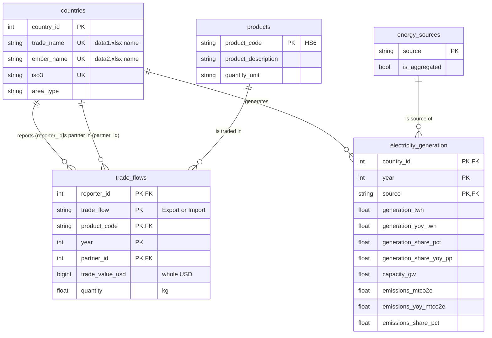
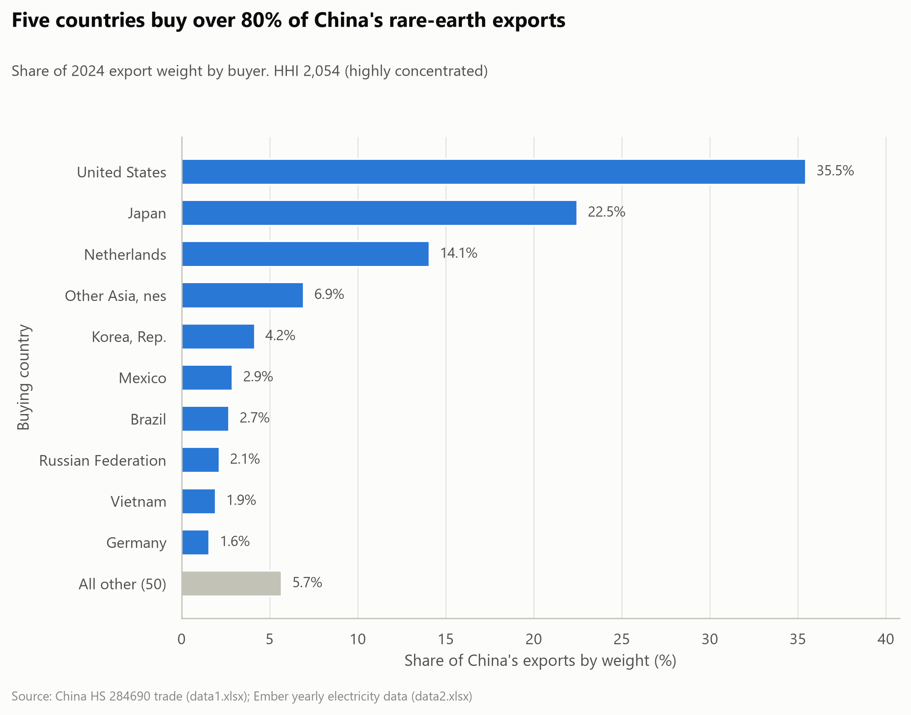
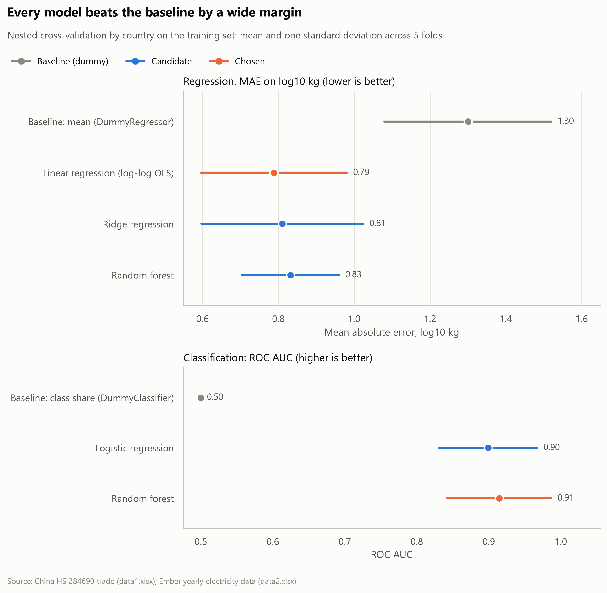

# Business Analytics Portfolio

## Project Overview
Brief description of your business problem and analytics solution.

## Business Problem
- What business challenge are you addressing?
- Why is this problem important?
- What impact will solving it have?

## Data Sources
- Description of data sources
- Data acquisition methods
- Data quality considerations

## Solution Architecture
- High-level system design
- Key components and their relationships
- Technology stack overview

## Setup Instructions

### Prerequisites
- Python 3.10+
- UV package manager
- Git

### Installation
1. Clone this repository:
   ```bash
   git clone https://github.com/bolorbud-gif/business-analytics-portfolio.git
   cd business-analytics-portfolio
   ```
2. Install dependencies into the project environment:
   ```bash
   uv sync
   ```

Full setup, including how authorized users supply the restricted source data: [docs/setup.md](docs/setup.md).

## Data Pipeline

### Build or refresh the database (one command)

```bash
uv run python scripts/run_pipeline.py            # real data in data/raw/ (not committed)
uv run python scripts/run_pipeline.py --sample   # committed synthetic sample, no access needed
```

This runs **extract → transform → validate → load** and writes a SQLite database to
`data/processed/rare_earth.db` (or `rare_earth_sample.db`). Progress goes to the console and
`logs/pipeline.log`. The command exits with `0` on success and `1` on failure (missing file,
bad structure, too many rejected rows, database error); the database is left unchanged on
failure. Add `--rebuild` to drop and recreate the tables.

Every run writes a quality report: [docs/quality_report.md](docs/quality_report.md) (real data)
and [docs/quality_report_sample.md](docs/quality_report_sample.md) (sample). Each report has
row counts, missingness, duplicates, rejected-record counts, the action taken on bad records,
and a re-runnability check.

### Database: 3NF tables + analysis views

The stored tables are normalized to third normal form ([docs/normalization.md](docs/normalization.md)).
The analysis outputs are SQL **views**: computed from the tables when queried, so they never go out of date.

| Stored table | One row is… |
|---|---|
| `countries` | One country, with its name in each source (`Korea, Rep.` ↔ `South Korea`) and ISO code |
| `products` | One HS6 product (code, description, unit) |
| `energy_sources` | One electricity source (Solar, Wind, Total generation, …) |
| `trade_flows` | China's rare-earth trade with one partner, in one direction, in one year (from `data1.xlsx`) |
| `electricity_generation` | One country's electricity from one source in one year (from `data2.xlsx`) |

| View | One row is… |
|---|---|
| `electricity_generation_detail` | `data2.xlsx` as it was: all 17 columns, with names |
| `partner_trade_energy` | One trade row plus the partner's power mix that year |
| `country_wind_imports` | One country in one year: imports from China (kg), import growth %, wind generation, wind change, wind capacity. Exported to `data/processed/country_wind_imports.csv` |
| `trade_wind_merged` | One `data1.xlsx` row matched to `country_wind_imports` on country + year. Exported to `trade_wind_merged.csv` |
| `trade_wind_wide` | Export and Import side by side, one row per country-year. Exported to `trade_wind_wide.csv` and `.xlsx` (one sheet) |

### Entity Relationship Diagram

The five stored tables (3NF) and how they relate. Views, field details and relationship rules are in
[docs/ERD.md](docs/ERD.md).



### How it works

| Stage | Module | What it does |
|---|---|---|
| Extract | `src/data_pipeline/extract.py` | Reads the Excel files listed in `config/app_config.yaml` with Pandas |
| Transform | `src/data_pipeline/transform.py` | Renames columns, repairs the swapped reporter header in `data1.xlsx`, then `normalize()` splits the data into the 3NF tables (checking each dependency first) |
| Validate | `src/data_pipeline/validate.py` | Pandera schemas: types, allowed values, ranges, uniqueness. Drops exact duplicates; rejects bad rows to `data/interim/` |
| Load | `src/data_pipeline/load.py` | SQLAlchemy tables with primary and foreign keys; replaces contents in one transaction, refreshes and validates the views, records before/after counts and checksums |
| Views | `src/data_pipeline/views.py` | SQL for the analysis views |
| Report | `src/data_pipeline/quality.py` | Builds the quality report |
| Orchestration | `src/data_pipeline/pipeline.py` | `run_pipeline()`: importable, used by the script, tests and notebooks |

### Re-runnability

Running the command twice with the same input doesn't duplicate rows or silently change counts.
Each run compares every table's row count and content checksum before and after loading. The
report's *Re-runnability check* table shows the result, and any change is logged as a warning.
`tests/test_data_pipeline.py::test_second_run_does_not_duplicate_or_change_rows` checks this automatically.

### Documentation

- [docs/ERD.md](docs/ERD.md): entity relationship diagram
- [docs/normalization.md](docs/normalization.md): 1NF / 2NF / 3NF analysis with evidence
- [docs/data_dictionary.md](docs/data_dictionary.md): every table and field, with type, key, source and business rule
- [docs/schema.sql](docs/schema.sql): generated `CREATE TABLE` / `INDEX` / `VIEW` statements
- [docs/setup.md](docs/setup.md): setup and supplying restricted data

### Other commands

```bash
uv run python scripts/setup_database.py                    # create empty tables only
uv run python scripts/setup_database.py --ddl docs/schema.sql   # regenerate schema SQL
uv run python scripts/make_sample_data.py                  # regenerate the synthetic sample
uv run python scripts/build_api_reference.py               # regenerate docs/api_reference.md
uv run pytest                                              # run the tests
```

## Exploratory Analysis (Assignment 5)

**Question:** does the wind build-out drive countries' demand for Chinese rare earths, and how exposed
are buyers? Start with the [executive summary](docs/executive_summary.md); the full analysis is in
[docs/statistical_analysis_report.md](docs/statistical_analysis_report.md).



| Deliverable | Where |
|---|---|
| Modular EDA Python package | [`src/analysis/`](src/analysis/): `exploratory.py` (connect, 19 quality checks, describe, concentration), `statistical.py` (correlation, partial correlation, regression, hypothesis tests, diagnostics), `charts.py` (visualization suite). Function reference: [docs/api_reference.md](docs/api_reference.md) |
| Statistical analysis report with business insights | [docs/statistical_analysis_report.md](docs/statistical_analysis_report.md) |
| Visualization suite (Matplotlib + Seaborn) | 11 figures in [`docs/figures/`](docs/figures/), indexed in the report's appendix. Every reported correlation has a scatter plot |
| Statistical testing and hypothesis validation | 5 hypotheses, each with its assumptions checked (Shapiro-Wilk, Levene), its business magnitude and effect size reported before the p-value, Holm correction, and statistical and business significance judged separately. Each hypothesis is re-checked as a log-log OLS regression, with robustness checks for missing years (PPML, balanced sample): notebook 02, sections 3–4, and report sections 6–7 |
| Descriptive statistics of the regression sample (Table 1) | Notebook 02, section 1.4, and report section 4 |
| Data-quality validation | [notebooks/01_data_exploration.ipynb](notebooks/01_data_exploration.ipynb) |
| Univariate, bivariate, multivariate analysis | [notebooks/02_eda_analysis.ipynb](notebooks/02_eda_analysis.ipynb) |
| Executive summary | [docs/executive_summary.md](docs/executive_summary.md) |

**Code architecture.** All analysis logic lives in the importable `src.analysis` package, and every
function has a docstring. The notebooks only import and call it, so they contain no function
definitions and no duplicated logic. Tests enforce all three rules
(`tests/test_analysis.py::test_every_analysis_function_has_a_docstring`,
`test_notebooks_import_the_package_and_define_no_functions`).

Re-run the notebooks after rebuilding the database. Without the real data they fall back to the
synthetic sample and say so; charts are saved to `docs/figures/` only from real data.

```bash
uv run jupyter nbconvert --to notebook --execute --inplace notebooks/01_data_exploration.ipynb notebooks/02_eda_analysis.ipynb
```

## Analytics Engine (Assignment 6)

**Problem type: supervised learning.** A regression (how much a country imports of Chinese rare-earth
compounds, log10 kg) and a binary classification (is it a **major buyer**, 10 tonnes or more a year?) on
the same rows. It isn't clustering, because every row has a known outcome. The features are **last year's
power-sector data**, which are published before this year's trade figures. So the engine can forecast,
size markets with no trade records, and turn each prediction into an action for a rare-earth supplier's
market-development team. Walkthrough: [notebooks/03_modeling_experiments.ipynb](notebooks/03_modeling_experiments.ipynb).

```bash
uv run python -m src.modeling.train                # train, tune, evaluate and save (about 2 minutes)
uv run python -m src.modeling.predict              # 2024: expected vs actual, with recommended actions
uv run python -m src.modeling.predict --year 2025  # forecast for a year with no trade data yet
```



| Result | Baseline (dummy) | Engine |
|---|---|---|
| Regression, cross-validated by country (mean ± SD, 5 folds) | MAE 1.30 ± 0.22 | **Linear regression:** MAE 0.79 ± 0.19 (typically off by 6×), R² 0.41 ± 0.40 |
| Regression, 14 held-out countries | MAE 1.55 (off by 36×) | MAE 1.02 (off by 10×; 95% CI 0.74–1.31), R² 0.48 |
| Classification, cross-validated by country | AUC 0.50; cost 0.56 ± 0.03 per country | **Random forest (depth 2):** AUC 0.91 ± 0.07; cost 0.28 ± 0.24 |
| Classification, 14 held-out countries | Cost 0.56 (flags everyone) | AUC 0.95 (CI 0.82–1.00); all 11 major buyers caught, 4 false alarms; cost 0.16 (CI 0–0.36) |

**Analytics checklist**

| Item | How the engine meets it | Where |
|---|---|---|
| Problem type stated explicitly | Supervised regression and binary classification, not clustering; also saved in the model bundle | Notebook intro; `train.PROBLEM_TYPES` |
| Baseline trained and reported alongside | `DummyRegressor` and `DummyClassifier` are the first row of every table and are scored on the same test set | §2; `evaluate.summarize_cv` |
| Train/test split done correctly, time-aware if time series | A quarter of the **countries** held out (stratified, used once), plus a train-2023/test-2024 check | §3; `train.split_by_country`, `evaluate.split_comparison` |
| All preprocessing inside a `Pipeline` | Impute → log10 → scale → model, refitted inside every fold. Measured: scoring on training rows makes the forest look 4× more accurate | §4; `train.build_pipeline`, `evaluate.classic_leak_vs_pipeline` |
| Every feature checked for availability at prediction time | Last year's power data only (`feature_lag_years: 1`); timing documented per feature and checked on the 2025 forecast rows; trade-derived columns forbidden and screened | §1.1, §4.3; `evaluate.feature_availability`, `evaluate.leakage_screen` |
| `random_state` set everywhere | One value in the config drives the split, every fold, every model and the bootstrap; a test checks every estimator | `config/model_params.yaml`; `tests/test_modeling.py` |
| Metric chosen from the business cost of each error | Log-scale MAE (a 2× miss costs the same for any market size). A missed major buyer costs 3 false alarms, and the threshold minimises expected cost; the choice holds for any ratio from 1:1 to 10:1 | §5.1, §6.1, §6.3 |
| Cross-validation with the standard deviation reported | Nested, by country; every metric with its SD | §5.2, §6.2, figure 12 |
| Hyperparameters tuned, or a documented reason not to | Grid search inside each training fold; plain linear regression has no hyperparameters (Ridge is its tuned version) | §5.2; `evaluate.nested_cv`, `evaluate.tune` |
| Full pipeline serialized with provenance | One `joblib` bundle: pipelines, threshold, costs, scores, plus the data's SHA-256, the git commit, the full config, `random_state` and versions. `models/` is git-ignored (fitted on restricted data) | §8; `train.provenance`, `predict.load_engine` |
| Model output translated into a recommended action | Approach, Grow, Verify, Keep or Low priority for every country, with the reason | §8; `predict.recommend` |
| Limitations stated honestly | Small data (bootstrap intervals on test scores), one product code, judgement calls, in-sample actions, associations not causes | §10 |

Re-run the notebook after training (without the real database it uses synthetic data and says so):

```bash
uv run jupyter nbconvert --to notebook --execute --inplace notebooks/03_modeling_experiments.ipynb
```

## Dashboard (Assignment 7)

An interactive Streamlit app that walks through the question, evidence, results and limitations from
Assignments 3–6. It runs locally and reproduces from a clean clone, with or without the restricted data.
Full guide: [docs/deployment.md](docs/deployment.md).

```bash
uv sync                                          # exact versions from uv.lock, Streamlit included
uv run python scripts/deploy.py run              # open http://localhost:8501 (committed real-data snapshot)
uv run python scripts/deploy.py run --sample     # rebuild everything from the synthetic sample, then launch
uv run python scripts/deploy.py check            # with the real data: rebuild and compare with the snapshot
```

**The one conclusion it makes clear:** country size, not wind, drives demand for Chinese rare-earth
compounds, so demand should be sized from a country's power system, not its wind targets. The design
(the conclusion, the page hierarchy, the data-access layer, the notes and the error states) and the
rehearsed presentation path are in [docs/deployment.md](docs/deployment.md).

| Section | Page | What a reader can do |
|---|---|---|
| Start here | **The answer** (primary) | Read the conclusion and four KPIs, the evidence in one chart, and what it means |
| The case | 1 · Why: wind or size? | Filter by year and country size (the regressions are refitted), plot imports against any power measure, remove country size, read H1–H5 |
| The case | 2 · What to do | Filter countries by action (Approach, Grow, Verify, Keep, Low priority); see the 2025 forecast |
| More detail | Market evidence | Pick a year and the number of buyers; see the fixed-volume price fall and the wind build-out |
| More detail | Predictive engine | Compare models with the baseline; move the cost ratio and threshold and watch precision, recall and cost |
| More detail | Data and pipeline | See sources, coverage and the 19 quality checks; filter and download the analysis sample |
| About | Limitations and reproducibility | Limitations, the provenance of every number, and how to reproduce them |

Filters are in the sidebar. Under every title a caption gives the years the data cover and when the results
were built, and every evidence page ends with its sample, uncertainty, provenance and limitations.

**How it stays reproducible.** The app only reads a results snapshot, built by
[`src/dashboard/data.py`](src/dashboard/data.py) from the Assignment 4 database and the saved Assignment 6
engine artifact, with the same functions as the notebooks. The real snapshot is committed in [`data/published/`](data/published/) with its data fingerprint and git
commit. `deploy.py check` rebuilds it from the real data and compares every number, and
`deploy.py run --sample` rebuilds the whole chain from the committed synthetic data.
`tests/test_dashboard.py` opens every page headlessly on both snapshots.
