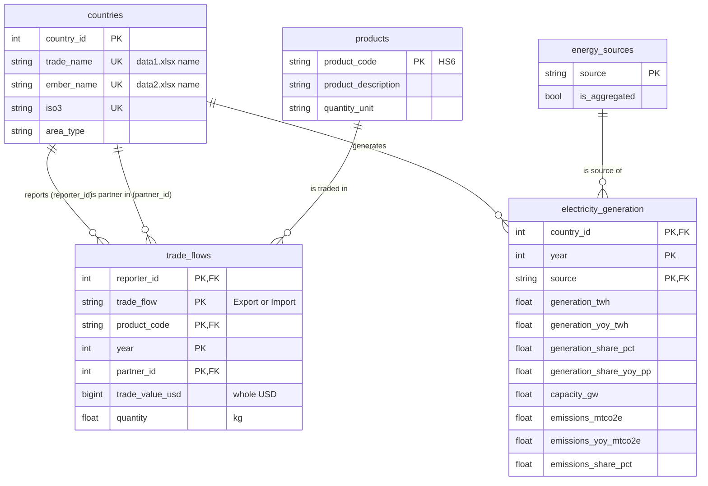

# Business Analytics Portfolio

## Project Overview
Brief description of your business problem and analytics solution.

## Business Problem
- What business challenge are you addressing?
- Why is this problem important?
- What impact will solving it have?

## Data Sources
- Description of data sources
- Data acquisition methods
- Data quality considerations

## Solution Architecture
- High-level system design
- Key components and their relationships
- Technology stack overview

## Setup Instructions

### Prerequisites
- Python 3.10+
- UV package manager
- Git

### Installation
1. Clone this repository:
   ```bash
   git clone https://github.com/bolorbud-gif/business-analytics-portfolio.git
   cd business-analytics-portfolio
   ```
2. Install dependencies into the project environment:
   ```bash
   uv sync
   ```

Full setup, including how authorized users supply the restricted source data: [docs/setup.md](docs/setup.md).

## Data Pipeline

### Build or refresh the database (one command)

```bash
uv run python scripts/run_pipeline.py            # real data in data/raw/ (not committed)
uv run python scripts/run_pipeline.py --sample   # committed synthetic sample, no access needed
```

This runs **extract → transform → validate → load** and writes a SQLite database to
`data/processed/rare_earth.db` (or `rare_earth_sample.db`). Progress goes to the console and
`logs/pipeline.log`. The command exits with `0` on success and `1` on failure (missing file,
bad structure, too many rejected rows, database error); the database is left unchanged on
failure. Add `--rebuild` to drop and recreate the tables.

Every run writes a quality report: [docs/quality_report.md](docs/quality_report.md) (real data)
and [docs/quality_report_sample.md](docs/quality_report_sample.md) (sample). Each report has
row counts, missingness, duplicates, rejected-record counts, the action taken on bad records,
and a re-runnability check.

### Database: 3NF tables + analysis views

The stored tables are normalized to third normal form ([docs/normalization.md](docs/normalization.md)).
The analysis outputs are SQL **views**: computed from the tables when queried, so they never go out of date.

| Stored table | One row is… |
|---|---|
| `countries` | One country, with its name in each source (`Korea, Rep.` ↔ `South Korea`) and ISO code |
| `products` | One HS6 product (code, description, unit) |
| `energy_sources` | One electricity source (Solar, Wind, Total generation, …) |
| `trade_flows` | China's rare-earth trade with one partner, in one direction, in one year (from `data1.xlsx`) |
| `electricity_generation` | One country's electricity from one source in one year (from `data2.xlsx`) |

| View | One row is… |
|---|---|
| `electricity_generation_detail` | `data2.xlsx` as it was: all 17 columns, with names |
| `partner_trade_energy` | One trade row plus the partner's power mix that year |
| `country_wind_imports` | One country in one year: imports from China (kg), import growth %, wind generation, wind change, wind capacity. Exported to `data/processed/country_wind_imports.csv` |
| `trade_wind_merged` | One `data1.xlsx` row matched to `country_wind_imports` on country + year. Exported to `trade_wind_merged.csv` |
| `trade_wind_wide` | Export and Import side by side, one row per country-year. Exported to `trade_wind_wide.csv` and `.xlsx` (one sheet) |

### Entity Relationship Diagram

The five stored tables (3NF) and how they relate. Views, field details and relationship rules are in
[docs/ERD.md](docs/ERD.md).



### How it works

| Stage | Module | What it does |
|---|---|---|
| Extract | `src/data_pipeline/extract.py` | Reads the Excel files listed in `config/app_config.yaml` with Pandas |
| Transform | `src/data_pipeline/transform.py` | Renames columns, repairs the swapped reporter header in `data1.xlsx`, then `normalize()` splits the data into the 3NF tables (checking each dependency first) |
| Validate | `src/data_pipeline/validate.py` | Pandera schemas: types, allowed values, ranges, uniqueness. Drops exact duplicates; rejects bad rows to `data/interim/` |
| Load | `src/data_pipeline/load.py` | SQLAlchemy tables with primary and foreign keys; replaces contents in one transaction, refreshes and validates the views, records before/after counts and checksums |
| Views | `src/data_pipeline/views.py` | SQL for the analysis views |
| Report | `src/data_pipeline/quality.py` | Builds the quality report |
| Orchestration | `src/data_pipeline/pipeline.py` | `run_pipeline()`: importable, used by the script, tests and notebooks |

### Re-runnability

Running the command twice with the same input doesn't duplicate rows or silently change counts.
Each run compares every table's row count and content checksum before and after loading. The
report's *Re-runnability check* table shows the result, and any change is logged as a warning.
`tests/test_data_pipeline.py::test_second_run_does_not_duplicate_or_change_rows` checks this automatically.

### Documentation

- [docs/ERD.md](docs/ERD.md): entity relationship diagram
- [docs/normalization.md](docs/normalization.md): 1NF / 2NF / 3NF analysis with evidence
- [docs/data_dictionary.md](docs/data_dictionary.md): every table and field, with type, key, source and business rule
- [docs/schema.sql](docs/schema.sql): generated `CREATE TABLE` / `INDEX` / `VIEW` statements
- [docs/setup.md](docs/setup.md): setup and supplying restricted data

### Other commands

```bash
uv run python scripts/setup_database.py                    # create empty tables only
uv run python scripts/setup_database.py --ddl docs/schema.sql   # regenerate schema SQL
uv run python scripts/make_sample_data.py                  # regenerate the synthetic sample
uv run python scripts/build_api_reference.py               # regenerate docs/api_reference.md
uv run pytest                                              # run the tests
```

## Exploratory Analysis (Assignment 5)

**Question:** does the wind build-out drive countries' demand for Chinese rare earths, and how exposed
are buyers? Start with the [executive summary](docs/executive_summary.md); the full analysis is in
[docs/statistical_analysis_report.md](docs/statistical_analysis_report.md).


| Deliverable | Where |
|---|---|
| Modular EDA Python package | [`src/analysis/`](src/analysis/): `exploratory.py` (connect, 19 quality checks, describe, concentration), `statistical.py` (correlation, partial correlation, regression, hypothesis tests, diagnostics), `charts.py` (visualization suite). Function reference: [docs/api_reference.md](docs/api_reference.md) |
| Statistical analysis report with business insights | [docs/statistical_analysis_report.md](docs/statistical_analysis_report.md) |
| Visualization suite (Matplotlib + Seaborn) | 9 figures in [`docs/figures/`](docs/figures/), indexed in the report's appendix |
| Statistical testing and hypothesis validation | 5 hypotheses with Holm correction, normality tests, bootstrap CI and regression diagnostics: notebook 02, section 4, and report section 7 |
| Data-quality validation | [notebooks/01_data_exploration.ipynb](notebooks/01_data_exploration.ipynb) |
| Univariate, bivariate, multivariate analysis | [notebooks/02_eda_analysis.ipynb](notebooks/02_eda_analysis.ipynb) |
| Executive summary | [docs/executive_summary.md](docs/executive_summary.md) |

Re-run the notebooks after rebuilding the database. Without the real data they fall back to the
synthetic sample and say so; charts are saved to `docs/figures/` only from real data.

```bash
uv run jupyter nbconvert --to notebook --execute --inplace notebooks/01_data_exploration.ipynb notebooks/02_eda_analysis.ipynb
```
