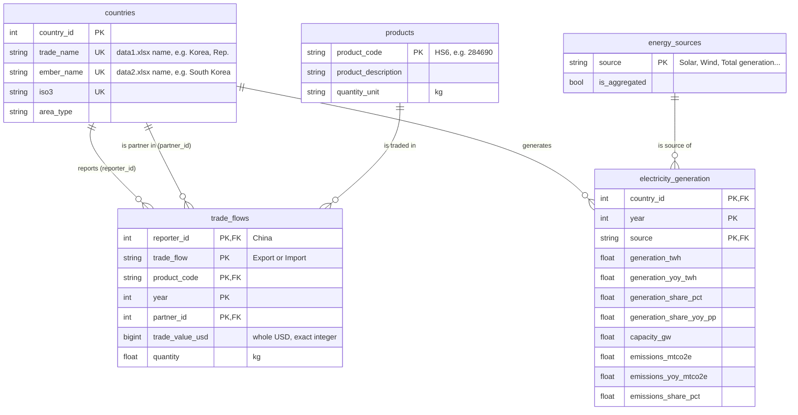
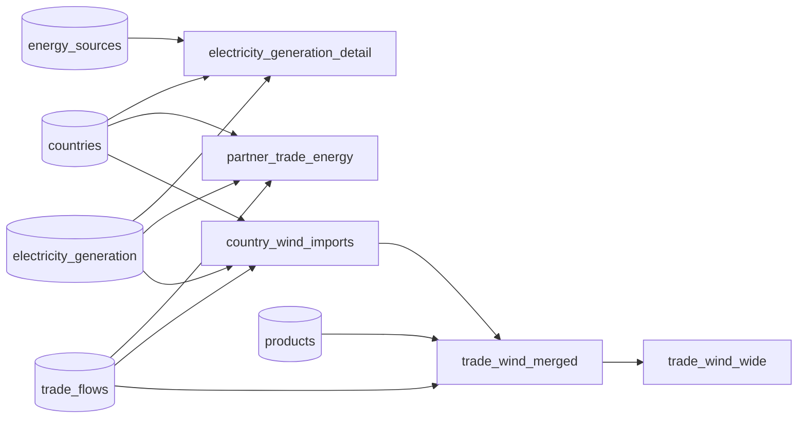

# Entity Relationship Diagram

Database: SQLite file `data/processed/rare_earth.db`, built by `uv run python scripts/run_pipeline.py`.
The stored tables are in **third normal form**; see [normalization.md](normalization.md) for the analysis.
Table definitions live in [`src/data_pipeline/load.py`](../src/data_pipeline/load.py) and views in
[`src/data_pipeline/views.py`](../src/data_pipeline/views.py). The generated SQL is in [`schema.sql`](schema.sql).
Field-level detail is in the [data dictionary](data_dictionary.md).

## Stored tables (3NF)

### Relationships

| Parent | Child | Cardinality | Enforced? |
|---|---|---|---|
| `countries` | `trade_flows` (as reporter) | 1 : many | **Yes**: FK `reporter_id` |
| `countries` | `trade_flows` (as partner) | 1 : many | **Yes**: FK `partner_id` |
| `products` | `trade_flows` | 1 : many | **Yes**: FK `product_code` |
| `countries` | `electricity_generation` | 1 : many | **Yes**: FK `country_id` |
| `energy_sources` | `electricity_generation` | 1 : many | **Yes**: FK `source` |
| `trade_flows` | `electricity_generation` | many : many through `countries` + `year` | Resolved in the views |

SQLite leaves foreign keys off by default, separately for **every connection**. The pipeline turns them on
for each of its connections (`PRAGMA foreign_keys = ON`) and runs `PRAGMA foreign_key_check` before
committing. For your own scripts and notebooks, open the database with
`src.data_pipeline.load.connect()`, which does the same; a bare `sqlite3.connect()` would
let orphan rows in. CHECK constraints also block negative money or quantities and unknown trade
directions at the database level.

## Analysis views (computed, not stored)

Each view is a saved `SELECT` over the tables above, so it can never disagree with them.
They're queried like tables (`SELECT * FROM trade_wind_wide`), and the pipeline also exports
three of them to CSV/Excel.

| View | Grain (one row is…) | Built from |
|---|---|---|
| `electricity_generation_detail` | one country, year and source, as in `data2.xlsx` (names, iso3, and the 3 recomputed 3NF columns) | electricity_generation + countries + energy_sources |
| `partner_trade_energy` | one trade flow plus the partner's power mix that year | trade_flows + countries + electricity_generation |
| `country_wind_imports` | one partner country (except China) in one year: imports from China, growth, wind | trade_flows + countries + electricity_generation (Wind) |
| `trade_wind_merged` | one `data1.xlsx` row matched to `country_wind_imports` on country + year | trade_flows + products + country_wind_imports |
| `trade_wind_wide` | one country-year with Export and Import side by side | trade_wind_merged |
