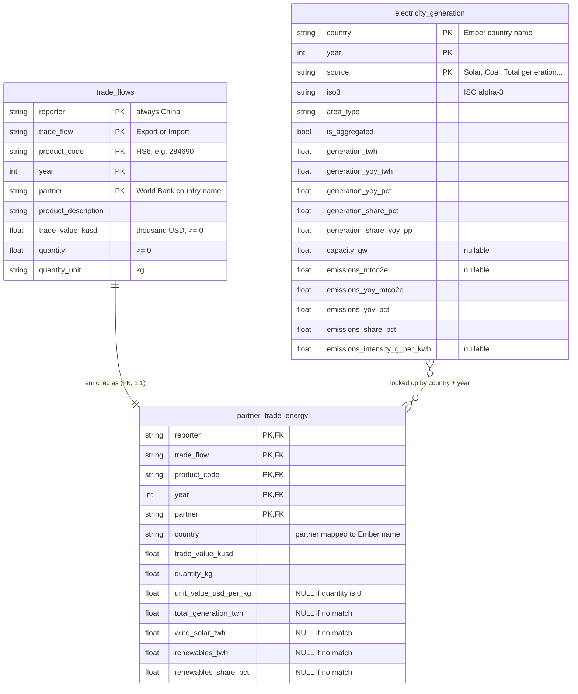

# Entity Relationship Diagram

Database: SQLite file `data/processed/rare_earth.db`, built by `uv run python scripts/run_pipeline.py`.
Table definitions live in [`src/data_pipeline/load.py`](../src/data_pipeline/load.py); the
generated SQL is in [`schema.sql`](schema.sql). Field-level detail is in the
[data dictionary](data_dictionary.md).

## Relationships

| From | To | Type | Enforced? | Rule |
|---|---|---|---|---|
| `partner_trade_energy` | `trade_flows` | Exactly one `partner_trade_energy` row per `trade_flows` row | **Yes**: composite foreign key on all 5 key columns (SQLite `PRAGMA foreign_keys = ON`) | The pipeline also checks that both tables have the same row count |
| `partner_trade_energy` | `electricity_generation` | Many-to-many lookup on `country` + `year` (each country-year has one row per source) | No: logical link only, because `electricity_generation`'s key also includes `source` | `country` comes from `partner` via the name map in `transform.py`. Partners with no match keep NULL electricity fields |

## Grain (what one row means)

| Table | One row is… | Kind |
|---|---|---|
| `trade_flows` | China's trade with one partner, in one direction, for one product and year | Fact (from `data1.xlsx`) |
| `electricity_generation` | One country's electricity from one source in one year | Fact (from `data2.xlsx`) |
| `partner_trade_energy` | One `trade_flows` row plus that partner's power mix in the same year | Derived analysis table |
