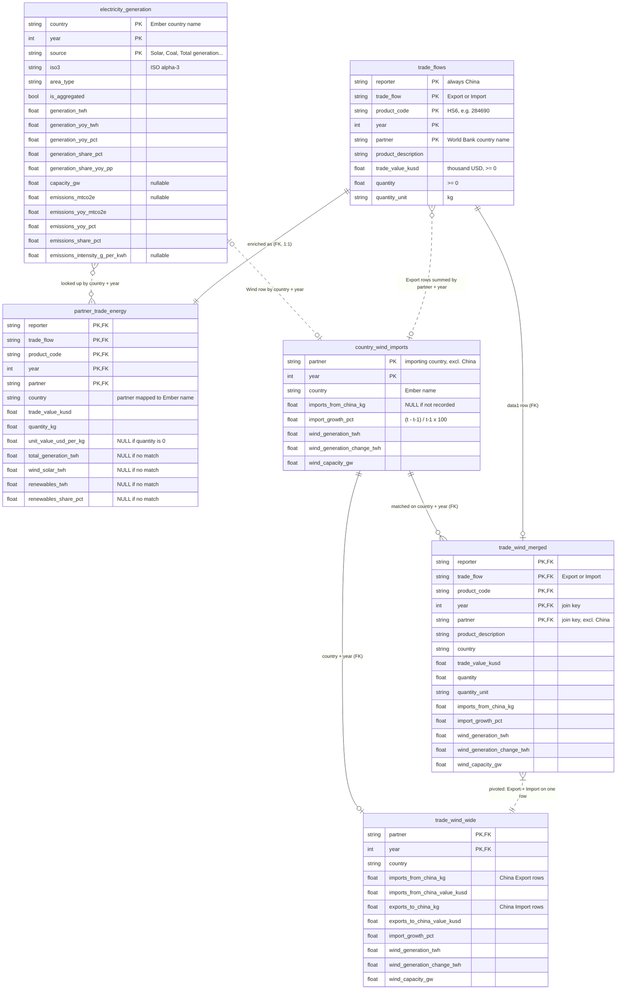

# Entity Relationship Diagram

Database: SQLite file `data/processed/rare_earth.db`, built by `uv run python scripts/run_pipeline.py`.
Table definitions live in [`src/data_pipeline/load.py`](../src/data_pipeline/load.py); the
generated SQL is in [`schema.sql`](schema.sql). Field-level detail is in the
[data dictionary](data_dictionary.md).

## Relationships

| From | To | Type | Enforced? | Rule |
|---|---|---|---|---|
| `partner_trade_energy` | `trade_flows` | Exactly one `partner_trade_energy` row per `trade_flows` row | **Yes**: composite foreign key on all 5 key columns (SQLite `PRAGMA foreign_keys = ON`) | The pipeline also checks that both tables have the same row count |
| `partner_trade_energy` | `electricity_generation` | Many-to-many lookup on `country` + `year` (each country-year has one row per source) | No: logical link only, because `electricity_generation`'s key also includes `source` | `country` comes from `partner` via the name map in `transform.py`. Partners with no match keep NULL electricity fields |
| `country_wind_imports` | `trade_flows` | One country-year summarizes 0 or more `Export` rows (`partner` + `year`) | No: aggregate, not a row-to-row link | Years with no Export row get NULL imports (not 0). China is excluded |
| `country_wind_imports` | `electricity_generation` | One country-year matches 0 or 1 `Wind` row (`country` + `year` + `source = 'Wind'`) | No: logical link | Countries with no wind data keep NULL wind fields |
| `trade_wind_merged` | `trade_flows` | Each `trade_flows` row appears at most once | **Yes**: composite FK on the 5 key columns | Only China's trade with itself is left out |
| `trade_wind_merged` | `country_wind_imports` | Many merged rows per country-year (one per trade flow) | **Yes**: FK on (`partner`, `year`) | This is the "match country and year" join |
| `trade_wind_wide` | `trade_wind_merged` | One wide row per country-year, made from its 1–2 merged rows | No: derived by pivot | Row count must equal distinct country-years in `trade_wind_merged` |
| `trade_wind_wide` | `country_wind_imports` | Each wide row matches one country-year | **Yes**: FK on (`partner`, `year`) | |

## Grain (what one row means)

| Table | One row is… | Kind |
|---|---|---|
| `trade_flows` | China's trade with one partner, in one direction, for one product and year | Fact (from `data1.xlsx`) |
| `electricity_generation` | One country's electricity from one source in one year | Fact (from `data2.xlsx`) |
| `partner_trade_energy` | One `trade_flows` row plus that partner's power mix in the same year | Derived analysis table |
| `country_wind_imports` | One country in one year: rare-earth imports from China, their growth, and wind power | Derived analysis table (panel) |
| `trade_wind_merged` | One `data1.xlsx` row plus that country's `country_wind_imports` values for the same year | Derived analysis table |
| `trade_wind_wide` | One country in one year with imports from China and exports to China side by side, plus wind | Derived analysis table (one sheet) |
