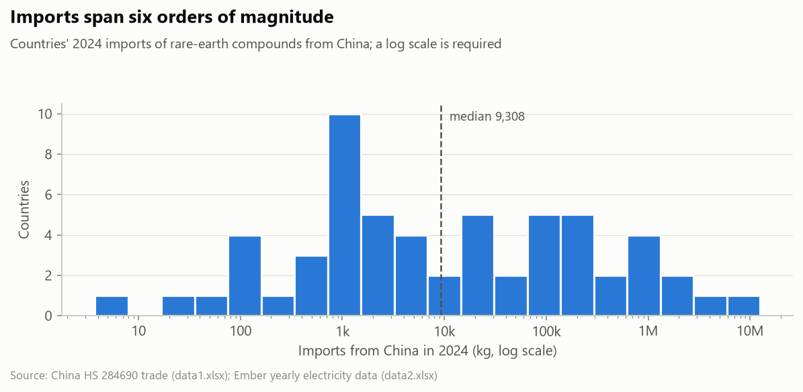
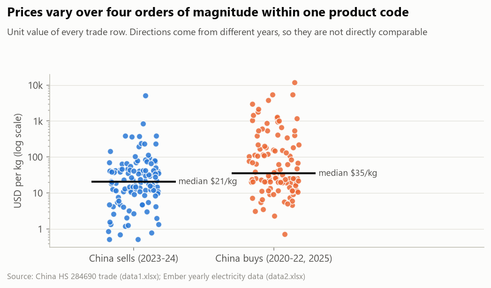
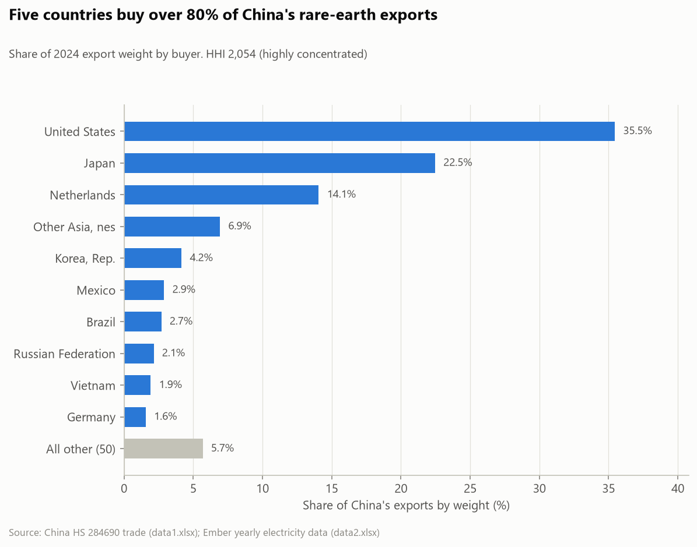
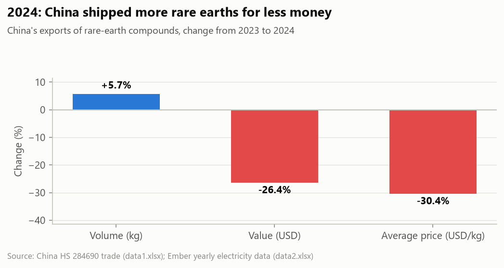
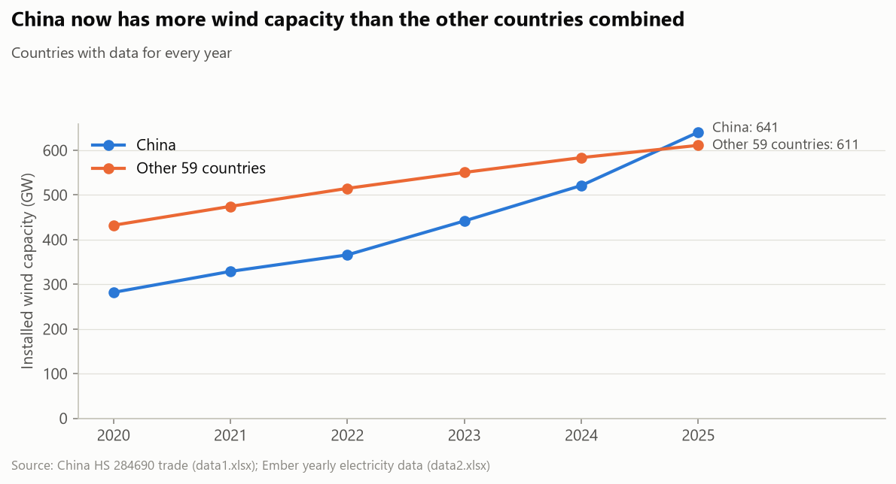
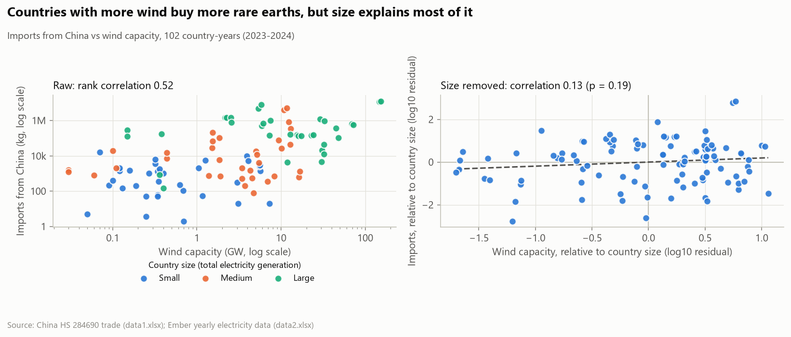
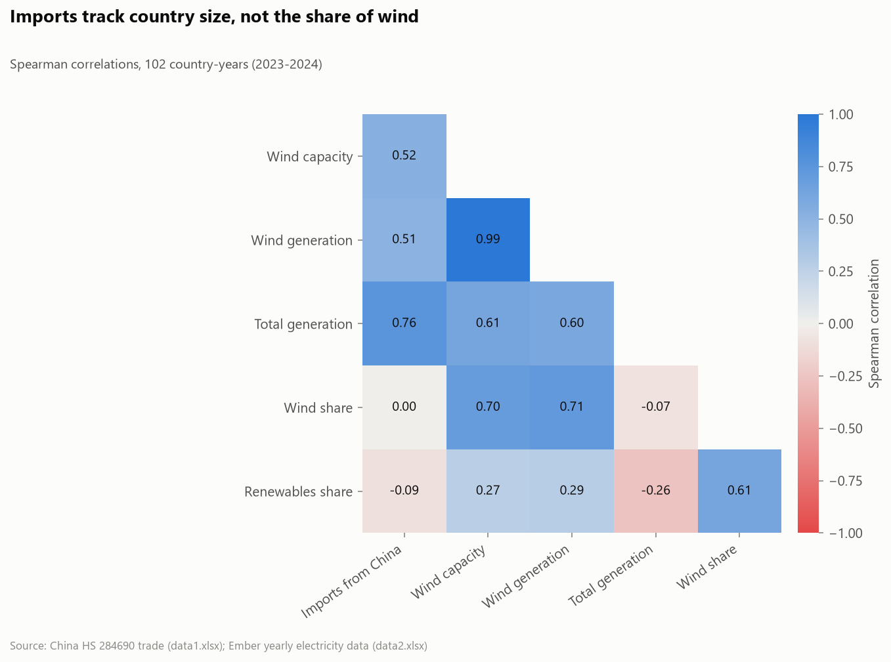

# Exploratory Analysis: Findings

**Assignment 5.** Analysis of the Assignment 4 database: China's trade in rare-earth compounds
(HS 284690) with 73 partners and electricity data for 70 countries, 2020–2025.
Code: [`src/analysis/`](../src/analysis/). Notebooks:
[01 data quality](../notebooks/01_data_exploration.ipynb) ·
[02 analysis](../notebooks/02_eda_analysis.ipynb). Business summary:
[executive_summary.md](executive_summary.md).

**Question:** does the build-out of wind power drive countries' demand for Chinese rare earths, and how
exposed are buyers to a concentrated supply relationship?

## 1. Data quality: trustworthy, but coverage is limited

All **19 data-quality checks pass**, run by `check_database()` against the database itself:
- **SQLite level:** file integrity, foreign keys on, no orphan rows.
- **Content:** every table populated.
- **Views:** every analysis view unique on its key and passing the pipeline's Pandera rules.
- **Cross-check:** the merged view keeps every trade row except re-imports.

The limitation is **coverage**, not quality. In `data1.xlsx` each year has only one trade direction:

| Year | 2020 | 2021 | 2022 | 2023 | 2024 | 2025 |
|---|---|---|---|---|---|---|
| Rows | China buys (Import) | Import | Import | China sells (Export) | Export | Import |

So **imports from China** exist for 2023–2024 only, and their **growth** for 2024 only (52 countries).
The multivariate analysis uses the **102 country-years** where imports, wind capacity and total
generation are all recorded.

## 2. Univariate findings

| Measure (2024, per country) | Median | Max | Skew |
|---|---:|---:|---:|
| Imports from China (kg) | 9,308 | 12,517,000 | 4.7 |
| Wind capacity (GW) | 1.4 | 152.7 | 4.9 |
| Total generation (TWh) | 89 | 4,391 | 5.2 |
| Import growth (%) | +21% | +557,690% | 7.0 |

- **Extreme skew.** Imports span six orders of magnitude, from 4 kg to 12,500 tonnes. Means are
  misleading, so the analysis uses medians, rank correlation and log scales.
- **Growth explodes from small bases.** In 2024, 56% of countries bought more than in 2023. The median
  change was +21%, with an interquartile range of −49% to +181%. Nine countries changed by more than
  500%, which pushes the *mean* above 11,000%.
- **Price per kg varies more than 1,000-fold** within the single product code, from under $1 to over
  $10,000 per kg. HS 284690 bundles cheap oxides with costly separated elements, so **kilograms
  measure demand better than dollars**.

## 3. Bivariate findings

**Demand for China's exports is highly concentrated.** In 2024 five buyers took **83.1%** of the
volume: the United States alone took 35.5% and Japan 22.5%. The Herfindahl-Hirschman Index is
**2,054**, which counts as *highly concentrated*.

**China shipped more for less in 2024.** Export volume rose **5.7%**, but value fell **26.4%**, so the
average price fell **30.4%**, from $15.3 to $10.7 per kg.

**Wind power keeps growing, led by China.** In the 60 countries with complete data, wind capacity rose
**75%**, from 714 GW (2020) to 1,252 GW (2025). China grew **127%**, from 282 to 641 GW, and now has
more capacity than the other 59 countries combined (611 GW).

**Imports rise with wind capacity, but more with country size** (Spearman, 102 country-years):

| Pair | ρ | p |
|---|---:|---:|
| Imports vs wind capacity | 0.52 | < 0.001 |
| Imports vs total generation (size) | **0.76** | < 0.001 |
| Wind capacity vs total generation | 0.61 | < 0.001 |
| Imports vs **wind share** of generation | 0.00 | 0.99 |
| 2024 import growth vs wind generation change (n = 49) | 0.25 | 0.09 |

## 4. Multivariate findings: the wind link is mostly size

Big economies build more wind *and* import more of everything, so size **confounds** the wind
relationship. Removing it:

| Analysis | Wind effect | Significant? | R² |
|---|---|---|---:|
| Raw rank correlation | ρ = 0.52 | yes | |
| Partial correlation, size removed (log10) | r = 0.13 | no (p = 0.19) | |
| Model A: log imports ~ log wind + year | elasticity **0.94** (95% CI 0.61–1.27) | yes | 0.29 |
| Model B: + log total generation | elasticity **0.20** (95% CI −0.12–0.52) | no (p = 0.22) | 0.58 |

In Model B the **size elasticity is 1.74** (95% CI 1.26–2.22, p < 0.001): a country with 1% more
electricity generation imports about 1.7% more rare-earth compounds from China. Standard errors are
clustered by country, and both models include a year effect.

**Conclusion:** at the country level, wind capacity has **no clear effect of its own** on imports of
rare-earth *compounds* once size is held constant. That doesn't mean wind needs no rare earths. Wind
turbines use rare earths mostly inside **permanent magnets**, a different product code, often made in
China and shipped as finished magnets rather than compounds.

## 5. Implications for the modeling approach (Assignment 6)

| # | Finding | Modeling decision |
|---|---|---|
| 1 | Skew 4–7 in every size measure | Model **log** quantities; interpret coefficients as elasticities |
| 2 | Size explains most of the wind link | **Always control for size** (total generation; add GDP and industrial output if available) |
| 3 | No link with wind *share* | Use absolute capacity or **capacity additions**, not shares |
| 4 | Growth from small bases explodes | Model growth as a **log ratio**, or require a minimum base |
| 5 | Imports only for 2023–2024 | Re-download `data1.xlsx` with exports for **all years** before any panel or forecasting model; until then it's a cross-section, n = 102 |
| 6 | Price varies more than 1,000-fold within one code | Predict **kg**; model value separately |
| 7 | Five buyers hold 83% of volume | Test robustness **without the US and Japan**; consider weighted or quantile regression |
| 8 | Magnets aren't in HS 284690 | Add **permanent magnets (HS 850511)** to test the wind hypothesis directly |

## 6. Limitations

- **One product code.** HS 284690 is compounds only. Metals, oxides under other codes, and magnets are
  outside the data.
- **Directions in different years.** Export and Import rows come from different years, so comparisons
  between directions also compare years.
- **Observational data.** Correlations and elasticities describe association, not cause.
- **Unmatched partners.** "Other Asia, nes" (usually Taiwan in UN Comtrade reporting) is a top-5 buyer
  but has no electricity data, so it's excluded from the multivariate analysis, along with Peru,
  Venezuela and a few others.
