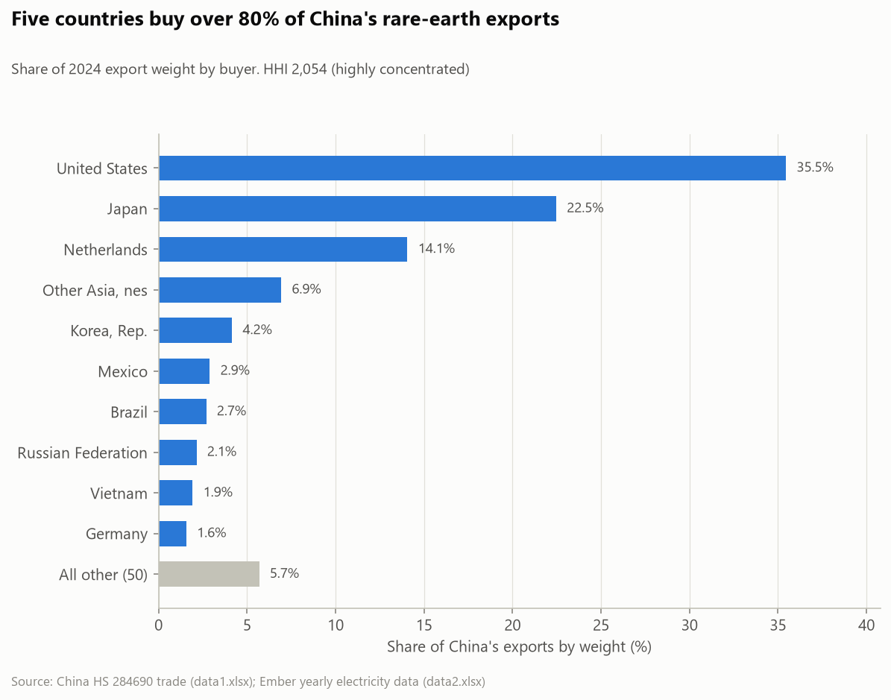
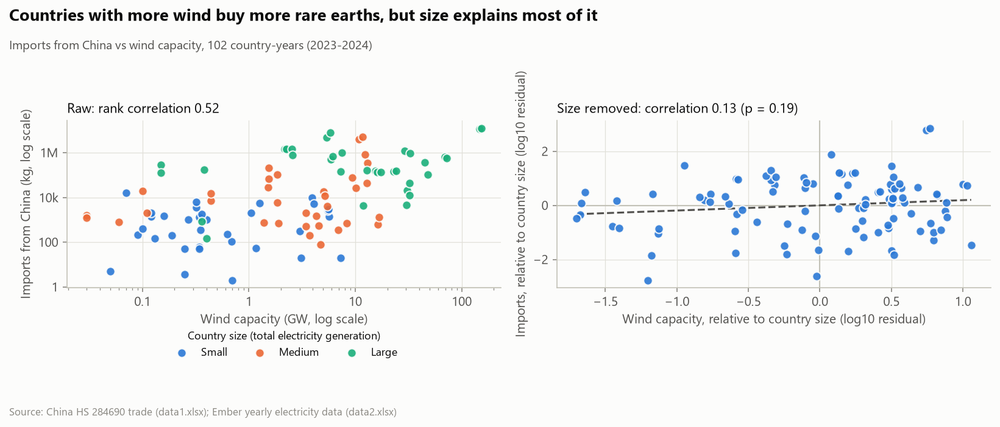

# Executive Summary: Rare-Earth Demand and the Wind Build-Out

*Assignment 5 · Exploratory analysis of China's rare-earth compound trade (HS 284690) and national
wind power, 2020–2025. Details: [eda_findings.md](eda_findings.md).*

## The question

Wind turbines are a major new use of rare earths, and China dominates their supply. Does the global
wind build-out drive countries' purchases of Chinese rare earths, and how exposed are buyers?

## Key findings

1. **Five countries take 83% of China's rare-earth compound exports.** The United States (35.5%) and
   Japan (22.5%) alone take 58%. The market is highly concentrated, with an HHI of 2,054.

   

2. **Prices fell sharply in 2024.** China shipped 5.7% more by weight but earned 26.4% less, so the
   average price fell 30%, from $15.3 to $10.7 per kg.

3. **Wind capacity is growing fast, and China is building the most.** Capacity across 60 countries
   rose 75% from 2020 to 2025. China more than doubled its own (+127%) and now exceeds the other 59
   countries combined.

4. **Country size, not wind, best predicts who buys.** Countries with more wind do import more
   (correlation 0.52), but that's because large economies have more of both. Once size is accounted
   for, wind capacity adds no significant explanation (correlation 0.13, p = 0.19). Size alone carries
   an elasticity of about 1.7.

   

## Business implications

- **Concentration risk sits with a few buyers.** An export restriction or price change by China would
  hit the US, Japan and the Netherlands first. Their buyers should prioritise supplier diversification
  and stockpiles.
- **Low 2024 prices are an opportunity and a warning.** Buyers can lock in supply cheaply. Producers
  outside China face margin pressure, which can slow the very diversification buyers need.
- **Don't forecast rare-earth demand from wind targets alone.** Overall economic and industrial size
  predicts compound imports far better. Wind's rare-earth demand probably arrives as finished
  **permanent magnets**, which this product code doesn't capture.
- **China's own wind boom may tighten supply.** Its domestic capacity more than doubled, so more of its
  rare-earth output may be used at home rather than exported. This is a hypothesis for the next stage.

## Recommendations for the next stage (modeling)

1. **Complete the data.** Obtain China's exports for every year 2020–2025; today only 2023–2024 exist,
   so growth can be measured for one year only.
2. **Add permanent magnets (HS 850511)** to test the wind link where it is most likely to appear.
3. **Model log quantities with size controls**, test robustness without the two largest buyers, and
   treat growth as a log ratio.

## Confidence and limits

The data passes all 19 quality checks. Findings describe **associations** in a short window (102
country-years). They aren't causal estimates, and they cover rare-earth *compounds* only.
