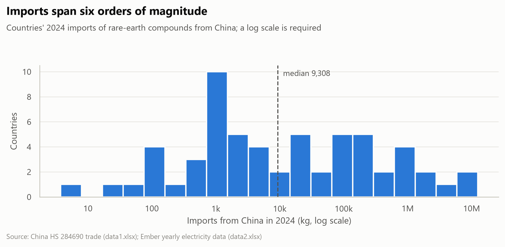
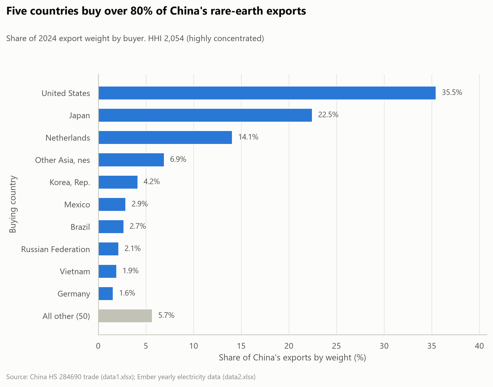
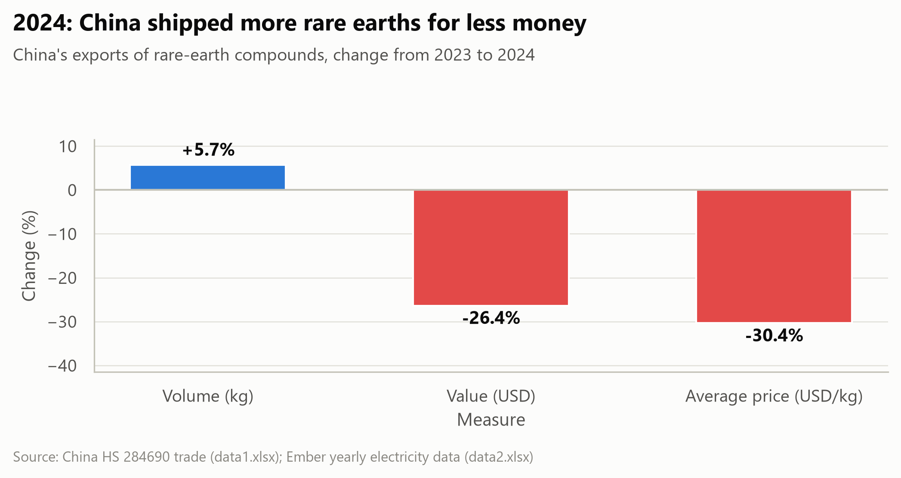
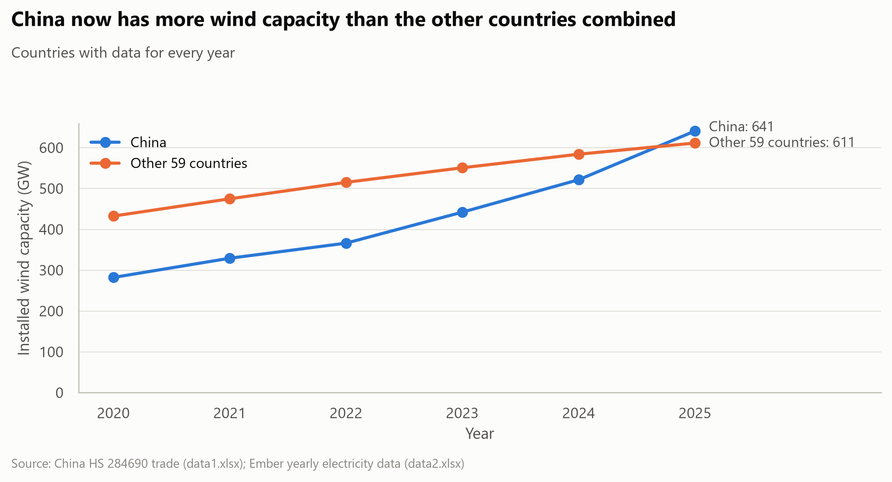
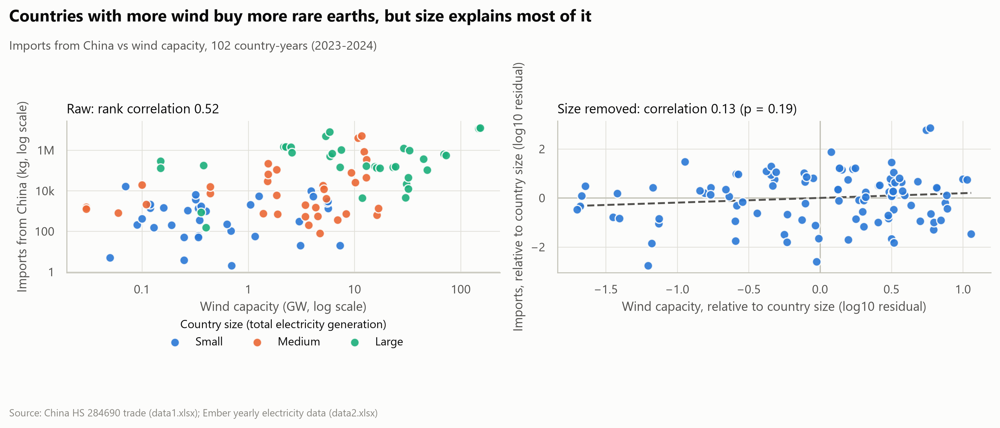

# Statistical Analysis Report: Rare-Earth Demand and the Wind Build-Out

**Assignment 5.** Exploratory and statistical analysis of the Assignment 4 database: China's trade in
rare-earth compounds (HS 284690) with 73 partners, and electricity data for 70 countries, 2020–2025.

| | |
|---|---|
| **Business question** | Does the wind build-out drive countries' demand for Chinese rare earths, and how exposed are buyers to a concentrated supply relationship? |
| **Code** | [`src/analysis/`](../src/analysis/): reusable package ([function reference](api_reference.md)) |
| **Notebooks** | [01 data quality](../notebooks/01_data_exploration.ipynb) · [02 analysis and tests](../notebooks/02_eda_analysis.ipynb) |
| **Business summary** | [executive_summary.md](executive_summary.md) |

## 1. Summary of results

| # | Hypothesis | Test | Result | Holm p | Verdict |
|---|---|---|---|---:|---|
| H1 | Imports from China rise with wind capacity | Spearman | ρ = 0.52, n = 102 | < 0.001 | ✅ Supported |
| H2 | Wind still matters after controlling for country size | Partial correlation (log10) | r = 0.13 | 0.22 | ❌ Not supported |
| H3 | Faster wind growth goes with faster import growth (2024) | Spearman | ρ = 0.25, n = 49 | 0.22 | ❌ Not supported |
| H4 | Buyers paid less per kg in 2024 than in 2023 | Wilcoxon signed-rank, paired | median −11.0%, n = 52 | 0.22 | ❌ Not supported |
| H5 | Imports differ by country size | Kruskal-Wallis | H = 50.6, n = 102 | < 0.001 | ✅ Supported |

**In one sentence:** countries with more wind buy more rare-earth compounds from China *because they
are bigger economies*, not because of the wind. Demand is highly concentrated, and the headline 30%
price fall in 2024 mostly reflects **mix**: which buyers bought how much.

## 2. Data and quality

- **All 19 data-quality checks pass.** `check_database()` runs them against the database itself:
  - **SQLite level:** file integrity, foreign keys on, no orphan rows.
  - **Content:** every table populated.
  - **Views:** every analysis view unique on its key and passing the pipeline's Pandera rules.
  - **Cross-check:** the merged view keeps every trade row except re-imports.
- **Coverage is the limitation.** Each year in `data1.xlsx` has only one trade direction:

  | Year | 2020 | 2021 | 2022 | 2023 | 2024 | 2025 |
  |---|---|---|---|---|---|---|
  | Rows | China buys (Import) | Import | Import | China sells (Export) | Export | Import |

  So **imports from China** exist for 2023–2024 only, and their growth for 2024 only.
- **Analysis sample:** the 102 country-years with imports, wind capacity and total generation all
  recorded and positive. They're split into size terciles by total electricity generation.

## 3. Methods

| Choice | Reason |
|---|---|
| **Medians, rank (Spearman) correlation** | Every size measure is heavily right-skewed (skew 4–7) |
| **log10 scale for parametric work** | Raw imports fail Shapiro-Wilk (W = 0.33, p < 10⁻¹⁴); log10 imports pass (W = 0.98, p = 0.62) |
| **Partial correlation and log-log OLS** | To separate wind's effect from country size (a confounder). Coefficients are elasticities |
| **Clustered standard errors** | The same country appears in 2023 and 2024 |
| **Wilcoxon signed-rank on log ratios** | Paired before/after comparison without assuming normality; a halving and a doubling weigh equally |
| **Kruskal-Wallis** | Comparing three groups without assuming normality |
| **Percentile bootstrap (2,000 resamples)** | Uncertainty for statistics with no standard formula (top-5 share) |
| **Holm correction, α = 0.05** | Five hypotheses are tested, which keeps the overall false-positive rate at 5% |
| **Regression diagnostics** | Breusch-Pagan (equal variance), Jarque-Bera (normal residuals), VIF (collinearity) |

## 4. Univariate analysis

| Measure (2024, per country) | n | Median | Mean | Max | Skew |
|---|---:|---:|---:|---:|---:|
| Imports from China (kg) | 60 | 9,308 | 588,414 | 12,517,000 | 4.7 |
| Wind capacity (GW) | 66 | 1.4 | 8.9 | 152.7 | 4.9 |
| Total generation (TWh) | 68 | 89 | 279 | 4,391 | 5.2 |
| Wind share of generation (%) | 67 | 3.8 | 8.0 | 58.4 | 2.2 |
| Import growth (%) | 52 | +21 | +11,368 | +557,690 | 7.0 |

- **Imports span six orders of magnitude**, from 4 kg to 12,500 tonnes. The mean is 63 times the median.
- **Growth explodes from small bases.** In 2024, 56% of countries grew their imports, with a median of
  +21% and an interquartile range of −49% to +181%. Nine countries changed by more than 500%, which
  pushes the *mean* above 11,000%. The mean isn't meaningful here.
- **Price per kg varies more than 1,000-fold** within one product code, from under $1 to over $10,000.
  HS 284690 mixes cheap oxides with costly separated elements, so **kg is the better demand measure**.

## 5. Bivariate analysis

### 5.1 Concentration of demand

In 2024 the top five buyers took **83.1%** of China's export volume (95% bootstrap CI 60.7%–91.3%).
The United States alone took 35.5% and Japan 22.5%. The HHI is **2,054**, which counts as highly
concentrated (above 1,800). Even the lower end of the interval shows a concentrated market.

### 5.2 Volume, value and price

In aggregate, China's exports grew **5.7%** in weight but fell **26.4%** in value, so the average price
fell **30.4%**, from $15.3 to $10.7 per kg. **But the per-buyer test (H4) doesn't confirm a general price
fall.** For the 52 buyers present in both years, the median price change was −11.0%, and 62% paid less,
but this isn't statistically significant. The aggregate fall is driven by **mix**: in 2024 more of the
volume went to buyers and grades with lower unit values.

### 5.3 Wind power

In the 60 countries with complete data, wind capacity rose **75%**, from 714 GW to 1,252 GW
(2020–2025). China grew **127%**, from 282 to 641 GW, and now has more than the other 59 combined
(611 GW).

### 5.4 Pairwise correlations (Spearman, n = 102)

| Pair | ρ | p |
|---|---:|---:|
| Imports vs wind capacity | 0.52 | < 0.001 |
| Imports vs total generation (size) | **0.76** | < 0.001 |
| Wind capacity vs total generation | 0.61 | < 0.001 |
| Imports vs wind share of generation | 0.00 | 0.99 |
| 2024 import growth vs wind generation change (n = 49) | 0.25 | 0.09 |

## 6. Multivariate analysis

The pair plot shows the confounding directly. Large countries sit high on imports, wind capacity and
total generation together. On wind **share**, the three size groups overlap, and share shows no
pattern against imports.

| Model (log10 imports, year effect, SEs clustered by country) | Wind elasticity (95% CI) | Size elasticity (95% CI) | R² |
|---|---|---|---:|
| A: wind capacity only | **0.94** (0.61 to 1.27), p < 0.001 | | 0.29 |
| B: wind capacity + total generation | **0.20** (−0.12 to 0.52), p = 0.22 | **1.74** (1.26 to 2.22), p < 0.001 | 0.58 |

**Diagnostics for Model B:**

| Assumption | Test | Value | Verdict |
|---|---|---:|---|
| Equal variance of residuals | Breusch-Pagan p | 0.85 | ✅ No heteroskedasticity |
| Normal residuals | Jarque-Bera p | 0.71 | ✅ Normal |
| No multicollinearity | max VIF | 1.6 | ✅ Well below 5 |

The model is well specified. Wind and size are correlated, but not so much that their effects can't be
separated, so wind's insignificance in Model B is a genuine result.

## 7. Hypothesis tests: interpretation

- **H1 is supported:** imports rise with wind capacity.
- **H2 is rejected:** the link disappears once country size is held constant (partial r = 0.13).
  Model B and the coefficient plot show the same thing. Size has an elasticity of about 1.7: a country
  with 1% more electricity generation imports about 1.7% more.
- **H3 isn't supported:** countries that added more wind generation in 2024 didn't increase imports
  significantly more. The window is a single year.
- **H4 isn't supported per buyer**, which corrects the aggregate picture: see 5.2.
- **H5 is strongly supported:** median imports are 705 kg for small countries, 5,040 kg for medium
  ones and 229,432 kg for large ones.

## 8. Business insights

1. **Supply risk is concentrated in a few buyers.** The US, Japan and the Netherlands take most of
   China's exports and would feel any export restriction first. Diversifying suppliers and holding
   strategic stocks matters most for them.
2. **Don't read the 2024 "price crash" as a uniform discount.** The aggregate unit value fell 30%, but
   the typical buyer's price fell only about 11%, and not significantly. Contracts and budgets should
   be benchmarked per buyer or per grade, not against an average skewed by mix.
3. **Forecast compound demand from economic size, not wind targets.** Size explains imports far better
   than wind capacity. Wind's rare-earth demand probably arrives as **finished permanent magnets**, a
   different product code.
4. **China's own wind boom is a supply signal to watch.** Its capacity more than doubled, so more of
   its output may be used at home. This is a hypothesis to test in the next stage.

## 9. Implications for the modeling approach (Assignment 6)

| # | Evidence | Modeling decision |
|---|---|---|
| 1 | Skew 4–7; log values normal | Model **log** quantities; report elasticities |
| 2 | H2 rejected; size elasticity 1.7 | **Always control for size** (total generation; add GDP or industry if available) |
| 3 | Wind share unrelated to imports | Use absolute capacity or **capacity additions**, not shares |
| 4 | Growth explodes from small bases | Model growth as a **log ratio**, or set a minimum base |
| 5 | Imports only for 2023–2024 | **Complete `data1.xlsx`** (exports for every year) before panel or forecasting models |
| 6 | Aggregate price is mostly mix (H4) | Model prices per buyer, or decompose price vs mix |
| 7 | Top five buyers hold 83% | Robustness check **without the US and Japan** |
| 8 | Model B passes all diagnostics | Log-log OLS with clustered SEs is a sound **baseline**; compare against it |
| 9 | Magnets aren't in HS 284690 | Add **permanent magnets (HS 850511)** to test the wind hypothesis where it should appear |

## 10. Limitations

- **Short window.** Imports from China cover two years; growth tests use one.
- **One product code.** Rare-earth metals and magnets are outside HS 284690.
- **Directions in different years.** Comparing Export with Import rows also compares years.
- **Observational data.** Results are associations, not causal effects.
- **Unmatched partners.** "Other Asia, nes" (usually Taiwan in UN Comtrade reporting), a top-5 buyer,
  has no electricity data and is excluded from the multivariate analysis. So are Peru, Venezuela and
  a few others.

## Appendix: visualization suite

All figures are made by `src/analysis/charts.py` (Matplotlib + Seaborn) in one style and generated
by `notebooks/02_eda_analysis.ipynb`.

**Publication standards applied to every figure**
- **Resolution and format:** 300 dpi PNG for documents, plus a vector **SVG** of each figure for print or
  publication (same name, in `docs/figures/`).
- **Titles:** each title states the finding; a subtitle gives the measure, sample and years; a
  source line names the data.
- **Axes:** every axis is titled with its unit, log scales are marked as such, and large numbers are
  written 1k, 1M rather than 10³, 10⁶.
- **Legends:** shown for every chart with two or more series, at 9 pt or larger, placed so they don't
  cover data. Lines and bars also carry direct value labels.
- **Colour-blind safe:** the three series colours (blue, orange, aqua) passed the palette validator
  for every pair, including on scatter plots (worst colour-vision-deficiency difference ΔE 9.2;
  target ≥ 8). Diverging charts use blue ↔ red with a neutral gray midpoint, and every heatmap
  cell and bar is also labelled with its signed value.
- **No dual axes:** measures with different scales get separate panels.

**Chart type matched to the analytical question**

| Figure | Analytical question | Chart type and why | Library |
|---|---|---|---|
| [01_concentration](figures/01_concentration.png) | Who buys China's exports, and how concentrated is demand? | **Ranked horizontal bars**: compares shares across many categories with long names; the tail is folded into "All other" | Matplotlib |
| [02_price_drop](figures/02_price_drop.png) | Did volume, value and price move together in 2024? | **Diverging bars from zero**: signed percentage changes of three measures on one scale | Matplotlib |
| [03_wind_trend](figures/03_wind_trend.png) | How fast is wind capacity growing, and who leads? | **Line chart**: change over time; direct end labels | Matplotlib |
| [04_size_confound](figures/04_size_confound.png) | Is the wind–imports link real or driven by size? | **Two-panel scatter**: raw relationship coloured by size, next to the size-adjusted residuals | Matplotlib |
| [05_correlations](figures/05_correlations.png) | How do all the variables relate to one another? | **Correlation heatmap (lower triangle)**: each pair once, with a diverging scale and printed values | Seaborn |
| [06_distribution](figures/06_distribution.png) | What does the distribution of imports look like? | **Histogram on a log axis**: shape and skew of one variable spanning six orders of magnitude | Seaborn |
| [07_unit_values](figures/07_unit_values.png) | How much do prices vary, by direction? | **Strip plot with medians**: every observation visible for a modest n; log scale for spread | Seaborn |
| [08_pairplot](figures/08_pairplot.png) | Which variables move together, and where does size sit? | **Pair plot by group**: all pairwise relationships plus each variable's distribution at once | Seaborn |
| [09_elasticities](figures/09_elasticities.png) | How much does wind's estimated effect change once size is added? | **Coefficient (dot-and-interval) plot**: estimates with 95% CIs against a zero line | Matplotlib |

Reproduce: build the database (`uv run python scripts/run_pipeline.py`), then
`uv run jupyter nbconvert --to notebook --execute --inplace notebooks/02_eda_analysis.ipynb`.
