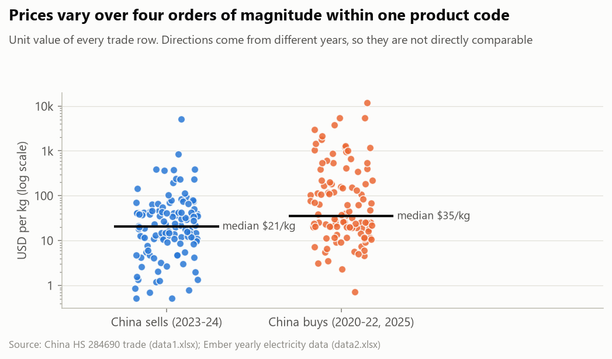
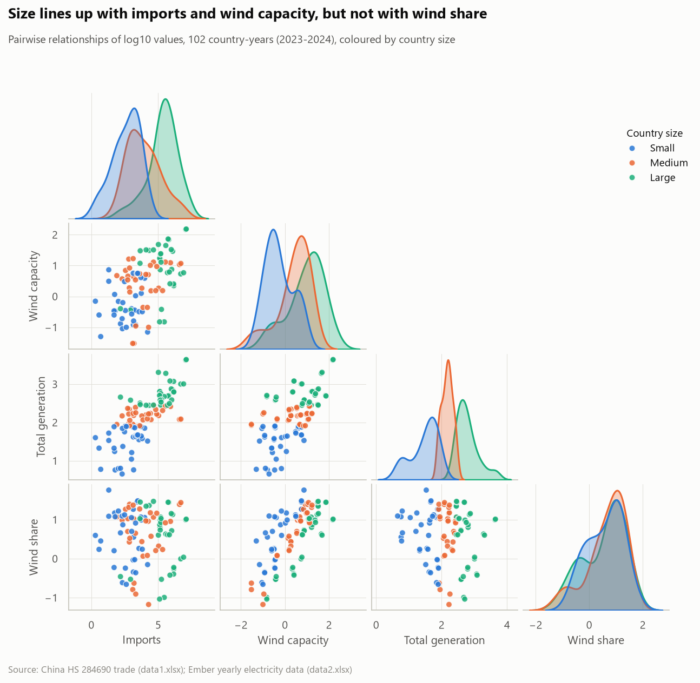
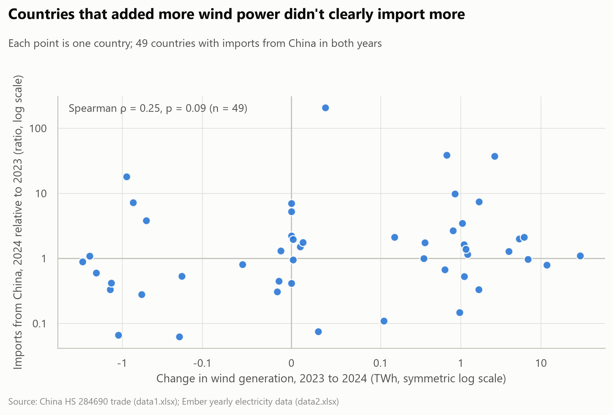
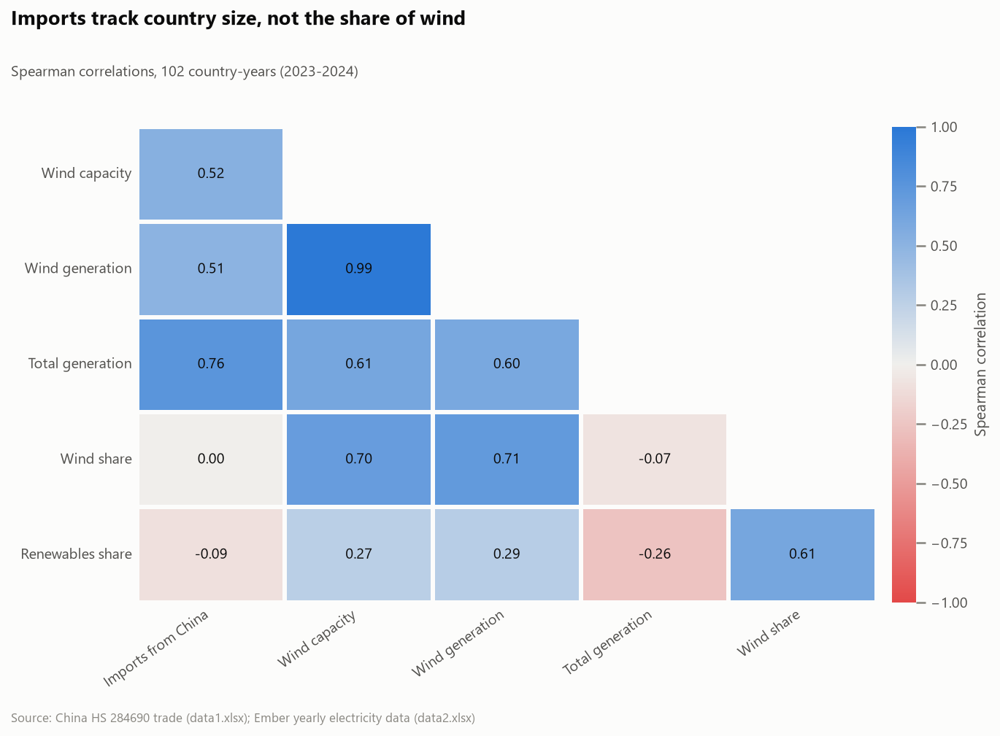
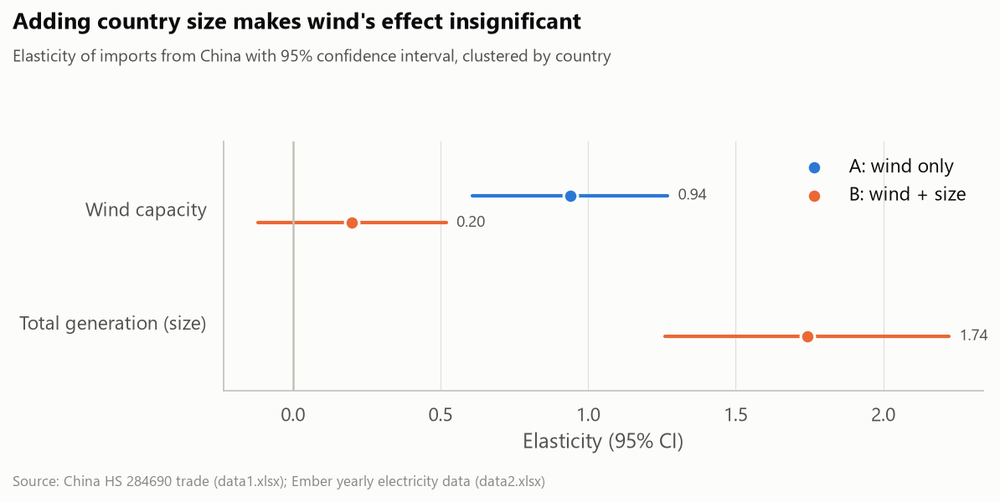
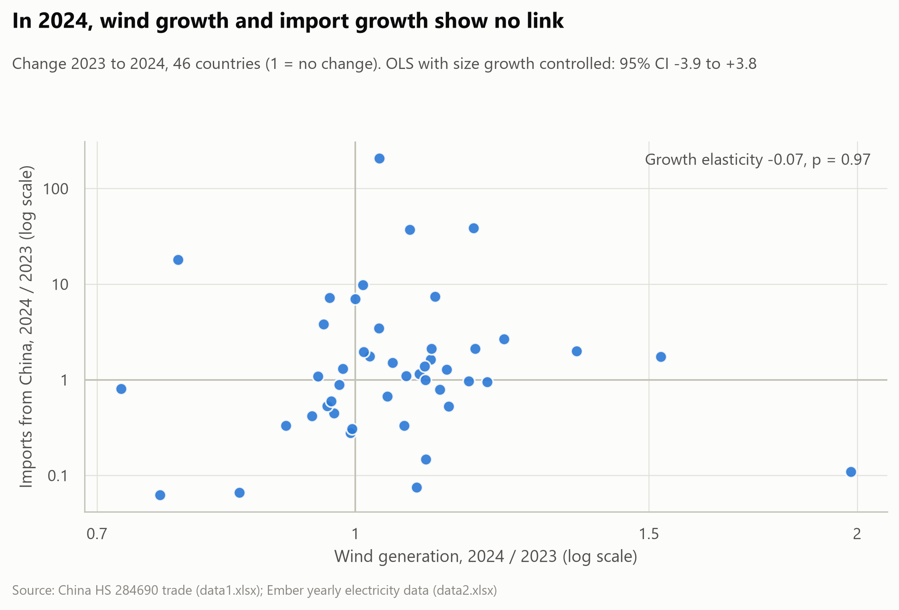

# Statistical Analysis Report: Rare-Earth Demand and the Wind Build-Out

**Assignment 5.** Exploratory and statistical analysis of the Assignment 4 database: China's trade in
rare-earth compounds (HS 284690) with 73 partners, and electricity data for 70 countries, 2020–2025.

| | |
|---|---|
| **Business question** | Does the wind build-out drive countries' demand for Chinese rare earths, and how exposed are buyers to a concentrated supply relationship? |
| **Code** | [`src/analysis/`](../src/analysis/): reusable package ([function reference](api_reference.md)) |
| **Notebooks** | [01 data quality](../notebooks/01_data_exploration.ipynb) · [02 analysis and tests](../notebooks/02_eda_analysis.ipynb) |
| **Business summary** | [executive_summary.md](executive_summary.md) |

## 1. Summary of results

Each result leads with its **business magnitude**, then the effect size, then the p-value. Statistical
and business significance are judged separately (section 7.3).

| # | Hypothesis | Business magnitude | Effect size | Holm p | Statistically significant? | Business significance |
|---|---|---|---|---:|---|---|
| H1 | Imports from China rise with wind capacity | 10× the wind capacity, 8.7× the imports | ρ = 0.52, moderate (n = 102) | < 0.001 | ✅ Yes | Large, but mostly country size (H2) |
| H2 | Wind still matters after controlling for country size | Same size, 10× the wind: 1.6× the imports (95% CI 0.76× to 3.3×) | partial r = 0.13, very weak | 0.26 | ❌ No | Inconclusive: can't rule out an effect that would matter |
| H3 | Faster wind growth goes with faster import growth (2024) | Median import growth +50% where wind grew most, −11% elsewhere | ρ = 0.25, weak (n = 49) | 0.26 | ❌ No | Would matter if real; one year can't confirm it |
| H4 | Buyers paid less per kg in 2024 than in 2023 | Median buyer −11% (95% CI −26% to +4%); at fixed volumes −35% | rank-biserial r = −0.29, weak (n = 52) | 0.26 | ❌ No | **Material**: the large buyers got large cuts |
| H5 | Imports differ by country size | Large countries' median imports are 325× small ones' | ε² = 0.50, large (n = 102) | < 0.001 | ✅ Yes | Material: size is the main demand driver |

**In one sentence:** countries with more wind buy more rare-earth compounds from China *because they
are bigger economies*. At the same size, wind's effect is small and can't be told apart from zero,
though an effect that matters can't be ruled out either. Demand is highly concentrated, and the 30% fall
in the average price in 2024 was a **real price fall** for the largest buyers (−35% at fixed volumes),
not a shift in which buyers bought.

**Regression check.** Re-testing every hypothesis as a log-log OLS regression gives the same verdicts
(7.5). The main model's conclusion also holds without the 16 partners that bought in only one of the two
years, and in a Poisson (PPML) model that counts their missing years as zero (section 6).

## 2. Data and quality

- **All 19 data-quality checks pass.** `check_database()` runs them against the database itself:
  - **SQLite level:** file integrity, foreign keys on, no orphan rows.
  - **Content:** every table populated.
  - **Views:** every analysis view unique on its key and passing the pipeline's Pandera rules.
  - **Cross-check:** the merged view keeps every trade row except re-imports.
- **Coverage is the limitation.** Each year in `data1.xlsx` has only one trade direction:

  | Year | 2020 | 2021 | 2022 | 2023 | 2024 | 2025 |
  |---|---|---|---|---|---|---|
  | Rows | China buys (Import) | Import | Import | China sells (Export) | Export | Import |

  So **imports from China** exist for 2023–2024 only, and their growth for 2024 only.
- **Analysis sample:** the 102 country-years with imports, wind capacity and total generation all
  recorded and positive. They're split into size terciles by total electricity generation, and
  described in Table 1 (section 4).

## 3. Methods

| Choice | Reason |
|---|---|
| **Assumptions checked before each test** | Shapiro-Wilk (normality) and Levene (equal variances, median-centred) decide which test is valid. Findings and consequences: section 7.1 |
| **Medians, rank (Spearman) correlation** | Every size measure is heavily right-skewed (skew 4–7) |
| **log10 scale for parametric work** | Raw imports fail Shapiro-Wilk (W = 0.33, p < 10⁻¹⁴); log10 imports pass (W = 0.98, p = 0.62) |
| **Every correlation is plotted before it is quoted** | A coefficient can hide curves, clusters or a few extreme points (section 5.4) |
| **Table 1 for the regression sample** | Describes the exact data the models use, on the raw and the log10 scale (section 4) |
| **Partial correlation and log-log OLS** | To separate wind's effect from country size (a confounder). Coefficients are elasticities |
| **Regression check of every hypothesis** | Log-log OLS (H1, H2, H5), OLS in log changes (H3: compares each country with itself) and the mean log price change (H4), each with a residual check (7.5) |
| **PPML (Poisson pseudo-maximum likelihood)** | The standard model for trade flows. It keeps the country-years with no recorded imports (as 0 kg), which a log model has to drop |
| **Balanced-sample re-estimate** | Checks that the partners that bought in only one of the two years don't drive the result |
| **Clustered standard errors** | The same country appears in 2023 and 2024 |
| **Sign test on paired log price ratios** | Per-buyer price changes are skewed, so neither the paired t-test (needs normality) nor Wilcoxon (needs symmetry) is safe. The sign test only counts rises and falls |
| **Kruskal-Wallis** | Comparing three groups without assuming normality |
| **Effect sizes with every test** | ρ and partial r; rank-biserial r (paired change); ε² (Kruskal-Wallis). Elasticities are also given in business terms: "10× x goes with k× y" |
| **Fixed-basket (Laspeyres) price index** | Separates a real price fall from a shift in which buyers bought (mix) |
| **Percentile bootstrap (2,000 resamples)** | Uncertainty for statistics with no standard formula (top-5 share, median price change) |
| **Holm correction, α = 0.05** | Five hypotheses are tested, which keeps the overall false-positive rate at 5% |
| **Regression diagnostics** | Breusch-Pagan (equal variance, the regression form of Levene), Shapiro-Wilk and Jarque-Bera (normal residuals), VIF (collinearity) |
| **Business significance judged separately** | Against stated materiality thresholds, not p-values (section 7.3) |

## 4. Univariate analysis

| Measure (2024, per country) | n | Median | Mean | Max | Skew |
|---|---:|---:|---:|---:|---:|
| Imports from China (kg) | 60 | 9,308 | 588,414 | 12,517,000 | 4.7 |
| Wind capacity (GW) | 66 | 1.4 | 8.9 | 152.7 | 4.9 |
| Total generation (TWh) | 68 | 89 | 279 | 4,391 | 5.2 |
| Wind share of generation (%) | 67 | 3.8 | 8.0 | 58.4 | 2.2 |
| Import growth (%) | 52 | +21 | +11,368 | +557,690 | 7.0 |

- **Imports span six orders of magnitude**, from 4 kg to 12,500 tonnes. The mean is 63 times the median.
- **Growth explodes from small bases.** In 2024, 56% of countries grew their imports, with a median of
  +21% and an interquartile range of −49% to +181%. Nine countries changed by more than 500%, which
  pushes the *mean* above 11,000%. The mean isn't meaningful here.
- **Price per kg varies more than 1,000-fold** within one product code, from under $1 to over $10,000.
  HS 284690 mixes cheap oxides with costly separated elements, so **kg is the better demand measure**.

### Table 1: descriptive statistics of the regression sample

The table above covers every country in 2024. The models use the **regression sample**: 102
country-years from 58 countries (51 in 2023, 51 in 2024), with imports, wind capacity and total
generation all recorded and positive.

| Variable | Mean | SD | Min | Median | Max | Skew | Shapiro-Wilk p |
|---|---:|---:|---:|---:|---:|---:|---:|
| Imports from China (kg) | 591,606 | 1,968,169 | 2 | 5,254 | 12,517,000 | 4.6 | < 0.001 |
| log10 imports | 3.94 | 1.57 | 0.30 | 3.72 | 7.10 | 0.03 | **0.16** |
| Wind capacity (GW) | 11.0 | 23.9 | 0.03 | 3.3 | 152.7 | 4.3 | < 0.001 |
| log10 wind capacity | 0.34 | 0.89 | −1.52 | 0.51 | 2.18 | −0.17 | 0.04 |
| Total generation, i.e. country size (TWh) | 347 | 665 | 4.5 | 152 | 4,391 | 4.6 | < 0.001 |
| log10 total generation | 2.14 | 0.62 | 0.66 | 2.18 | 3.64 | −0.23 | **0.22** |
| Wind share of generation (%) | 9.0 | 9.7 | 0.0 | 5.9 | 57.2 | 1.8 | < 0.001 |

| Correlation of log10 values (Pearson) | Wind capacity | Total generation |
|---|---:|---:|
| Imports from China | 0.53 | **0.76** |
| Wind capacity | | 0.61 |

**What Table 1 shows, and how it shapes the analysis**
1. **The raw variables are extremely skewed** (skew 4–5). The mean of imports is over 100 times the
   median, because a few very large buyers pull it up, so the data are described with **medians**.
2. **Logs remove the skew, which justifies log-log OLS.** On the log10 scale every skew is close to 0,
   and imports and size pass Shapiro-Wilk. Log wind capacity fails narrowly (p = 0.04). That doesn't
   matter for OLS, which needs normal **residuals**, not normal predictors, and Model B's residuals are
   normal (section 6).
3. **The correlations show the confounding before any test.** Size is more closely linked to imports
   (0.76) than wind is (0.53), and wind and size are linked to each other (0.61). So wind's own effect
   can only be judged with size held fixed (H2). Each pair has a scatter in the pair plot (5.4).

## 5. Bivariate analysis

### 5.1 Concentration of demand

In 2024 the top five buyers took **83.1%** of China's export volume (95% bootstrap CI 60.7%–91.3%).
The United States alone took 35.5% and Japan 22.5%. The HHI is **2,054**, which counts as highly
concentrated (above 1,800). Even the lower end of the interval shows a concentrated market.

### 5.2 Volume, value and price

In aggregate, China's exports grew **5.7%** in weight but fell **26.4%** in value, so the average price
fell **30.4%**, from $15.3 to $10.7 per kg.

**Was it a real price fall, or a shift in which buyers bought (mix)?** A fixed-basket price index prices
each buyer's 2023 volume at 2023 and at 2024 prices:

| Component, 2023 to 2024 | Change |
|---|---:|
| Average price per kg | −30.4% |
| **Price effect** (fixed 2023 volumes; 52 buyers, 99.99% of the volume) | **−34.8%** |
| Mix effect (shift between buyers) | +6.9% |

- **It's a price fall, not mix.** Mix actually *raised* the average, because more volume went to Japan,
  which pays more per kg than the US or the Netherlands.
- **The cut is concentrated in a few large buyers.** 77% of 2023 volume went to buyers whose price fell:
  Japan −62%, Korea −35%, the Netherlands −31%. The US, the largest buyer, paid 9% less. Japan drives
  about half of the fall: without it, the fixed-basket fall is 14%.
- **The typical buyer is a different question** (H4). With all 52 buyers weighted equally, the median
  change was −11% (95% CI −26% to +4%), which isn't statistically significant. Most buyers are small and
  their prices are noisy, so the typical buyer's change is uncertain even though the volume-weighted fall
  is large.
- **Caveat:** HS 284690 mixes grades, so a lower price per kg can also mean a switch to cheaper grades
  within a buyer. This data can't separate the two.

### 5.3 Wind power

In the 60 countries with complete data, wind capacity rose **75%**, from 714 GW to 1,252 GW
(2020–2025). China grew **127%**, from 282 to 641 GW, and now has more than the other 59 combined
(611 GW).

### 5.4 Pairwise relationships: plots first

Every correlation in this report is drawn before it is quoted. The pair plot covers all six measures in
the correlation matrix (section 6); the scatter below it covers growth.

| Pair (Spearman) | ρ | Strength | p | What the plot shows |
|---|---:|---|---:|---|
| Imports vs wind capacity (n = 102) | 0.52 | moderate | < 0.001 | An upward cloud, with large countries top-right |
| Imports vs total generation (size) | **0.76** | strong | < 0.001 | A tight upward band |
| Wind capacity vs total generation | 0.61 | strong | < 0.001 | An upward band: big countries build more wind |
| Imports vs wind share of generation | 0.00 | none | 0.99 | A shapeless cloud |
| 2024 import growth vs wind generation change (n = 49) | 0.25 | weak | 0.09 | Imports jump 10× up or down whatever happened to wind |

The pair plot shows the confounding directly. Large countries sit high on imports, wind capacity and
total generation together. On wind and renewables **shares**, the three size groups overlap, and the
shares show no pattern against imports. Wind generation and wind capacity are almost the same variable,
so only capacity is used in the models.

## 6. Multivariate analysis

The matrix summarises the same six measures as the pair plot in 5.4, so each coefficient has a scatter
panel there.

| Model (log10 imports, year effect, SEs clustered by country) | Wind elasticity (95% CI) | Size elasticity (95% CI) | R² | Business reading |
|---|---|---|---:|---|
| A: wind capacity only | **0.94** (0.61 to 1.27), p < 0.001 | | 0.29 | 10× the wind, 8.7× the imports |
| B: wind capacity + total generation | **0.20** (−0.12 to 0.52), p = 0.22 | **1.74** (1.26 to 2.22), p < 0.001 | 0.58 | Same size, 10× the wind: 1.6× the imports (0.76× to 3.3×). 10× the size: 55× the imports |

**Diagnostics for Model B:**

| Assumption | Test | Value | Verdict |
|---|---|---:|---|
| Equal variance of residuals | Breusch-Pagan p | 0.85 | ✅ No heteroskedasticity |
| Normal residuals | Shapiro-Wilk p | 0.33 | ✅ Normal |
| Normal residuals | Jarque-Bera p | 0.71 | ✅ Normal |
| No multicollinearity | max VIF | 1.6 | ✅ Well below 5 |

The model passes every check, so the wide interval for wind isn't caused by a broken model or by
collinearity. Once size is in the model, this data simply can't pin wind's own effect down: the interval
includes zero **and** an effect large enough to matter.

### Missing years: do they change the result?

A pooled regression doesn't need every country in every year. Each country-year is one row, and the
clustered standard errors allow for countries that appear once or twice. But a year with no recorded
imports can't be logged, so it drops out, and the model then describes how much countries buy *given
that they buy*.

| China's partners, 2023–2024 | Count |
|---|---:|
| Bought in both years | 52 |
| Bought in 2023 only | 8 |
| Bought in 2024 only | 8 |
| Bought in neither year | 4 |

A missing year is blank, never recorded as 0. The partners that skip a year are **small, occasional
buyers**: their typical recorded imports are 212 kg, against 15,892 kg for partners that buy every year
(Kruskal-Wallis p < 0.001). Bulgaria bought 2 kg, El Salvador 5 kg and Denmark 20 kg. So the gaps
aren't random. A blank most likely means China recorded no shipment that year, but the data can't
confirm a true zero. Model B was therefore re-estimated two more ways:

| Model B, re-estimated | n | Wind elasticity (95% CI) | Size elasticity (95% CI) |
|---|---:|---|---|
| All buyers, log-log OLS (baseline) | 102 | 0.20 (−0.12 to 0.52), p = 0.22 | 1.74 (1.26 to 2.22), p < 0.001 |
| Only buyers in both years | 88 | 0.15 (−0.15 to 0.46), p = 0.33 | 2.03 (1.47 to 2.59), p < 0.001 |
| PPML, missing years counted as 0 kg | 116 | 0.14 (−0.33 to 0.60), p = 0.57 | 1.05 (0.18 to 1.93), p = 0.02 |

**The conclusion doesn't depend on how the missing years are handled.** Wind stays small and not
significant, and size stays large and significant. PPML's size elasticity is lower because it gives more
weight to the largest importers, while the log model weights every country equally.

### Models the data can't support yet

- **Country fixed effects** use only each country's change over time. Over two years almost none of the
  variation is within a country: 0.1% for wind capacity, under 0.1% for size and 4.5% for imports. A
  fixed-effects estimate would rest on almost no information.
- **ARIMA** forecasts one country's series from its own past. It needs a long, evenly spaced series
  (around 50 points as a rule of thumb). Each country has at most two annual points, and the small buyers
  have gaps. **Monthly** trade data for 2020–2025 (72 points) would make it possible for the large,
  steady buyers.

## 7. Hypothesis tests

### 7.1 Assumption checks: what was found and what it changed

| Hypothesis and test | Assumption | Finding | Consequence |
|---|---|---|---|
| H1, H3: Spearman correlation | A monotonic relationship (no normality needed) | The scatters in 5.4 show straight-line or shapeless patterns, with no curve hiding a relationship | Spearman is appropriate |
| H2: partial correlation on log10 | Normal residuals | Imports residual normal (Shapiro-Wilk p = 0.16); wind residual **not** normal (p < 0.001, skew −0.8) | Checked with a rank-based partial correlation: r = 0.12, p = 0.24, the same conclusion. Model B's residuals are normal |
| H4: paired price change | Paired t-test: normal changes. Wilcoxon: symmetric changes | Log price changes are **not normal** (Shapiro-Wilk p < 0.001) and **skewed** (−1.5): a few buyers had very large falls | Neither test is safe, so H4 uses the **sign test** (p = 0.13). A paired t-test would have given p = 0.045, a false "significant"; Wilcoxon gives 0.07 |
| H5: Kruskal-Wallis across size groups | Similar spread in each group | Raw kg: not normal in any group (Shapiro-Wilk p < 0.001), and **unequal variances** (Levene p = 0.008). Log10 kg: **equal variances** (Levene p = 0.51); normal in the small and medium groups, borderline in the large group (p = 0.04) | Kruskal-Wallis needs no normality, and with equal spreads on the log scale its result reads as a shift in typical imports between groups |
| Model B (OLS) | Equal variance, normal residuals, no collinearity | All pass (section 6) | Clustered-SE OLS is a sound baseline |
| Regression check (7.5) | Normal residuals | H1, H2, H3 and H5 pass; H4's residuals are **not** normal (p < 0.001) | H4's regression p-value isn't used |

### 7.2 Effect sizes

| # | Effect size | Size | Business magnitude |
|---|---|---|---|
| H1 | Spearman ρ = 0.52 | moderate | 10× the wind capacity, 8.7× the imports |
| H2 | partial r = 0.13 | very weak | Same size, 10× the wind: 1.6× the imports (0.76× to 3.3×) |
| H3 | Spearman ρ = 0.25 | weak | Median import growth +50% where wind grew most, −11% elsewhere |
| H4 | rank-biserial r = −0.29 (62% of buyers paid less) | weak | Median buyer −11% (−26% to +4%); at fixed volumes −35% |
| H5 | ε² = 0.50 | large | Large countries' median imports 229 t, medium 5.0 t, small 0.7 t (325×) |

Conventions: ρ, r and rank-biserial r are called weak from 0.2, moderate from 0.4, strong from 0.6;
ε² is small from 0.01, medium from 0.08, large from 0.26.

### 7.3 Statistical significance is not business significance

A p-value only says whether an effect can be told apart from zero with this much data. Whether it
**matters** depends on how large it is. The materiality thresholds below are the analyst's judgement,
stated so they can be challenged:
- **Prices:** a change of **5% or more** in the price per kg is material for a buyer's budget or contract.
- **Demand drivers:** a driver is material for forecasting if 10× the driver goes with at least
  **2× the imports** (an elasticity of 0.3 or more).

| | Statistically significant? (Holm p) | Business significance |
|---|---|---|
| **H1** | Yes (< 0.001) | Large (8.7× per 10× wind), but **misleading on its own**: it is mostly country size |
| **H2** | No (0.26) | **Inconclusive.** The estimate (1.6×) is below the 2× threshold, but the interval reaches 3.3×. Not evidence that wind doesn't matter |
| **H3** | No (0.26) | **Would matter if real** (+50% vs −11%), but one year and 49 countries can't confirm it. Retest with more years |
| **H4** | No (0.26) | **Material.** The 35% fixed-basket fall is measured on China's whole export trade, not estimated from a sample. What isn't established is a cut for the *typical*, mostly small, buyer |
| **H5** | Yes (< 0.001) | **Material:** size is the main demand driver |

### 7.4 Interpretation

- **H1 and H5 are supported, with large effects.** Imports rise with wind capacity, and much more with
  country size.
- **H2 isn't supported, but that doesn't make wind irrelevant.** At the same size, wind's estimated
  effect shrinks from 0.94 to 0.20 and can't be told apart from zero; the data still allow an effect up
  to 0.52, which would matter.
- **H3 isn't supported.** Countries that added more wind in 2024 grew imports more in the median, but
  the variation is so large that one year can't confirm it.
- **H4 isn't supported for the typical buyer**, yet the price fall was real and large where the volume
  is (5.2). Not significant isn't the same as not important.

### 7.5 Regression check: each hypothesis as a log-log OLS

Each hypothesis was re-tested as a regression, with its residuals checked. H1, H2 and H5 come from
Models A and B (section 6). H3 becomes a regression in **changes** (log of 2024 / 2023), which compares
each country with itself. H4 becomes the mean log price change. Plot first:

| # | Regression | Business magnitude | Estimate | p | Holm p | Residuals normal? (Shapiro-Wilk p) | Regression verdict | Main test (7.3) |
|---|---|---|---:|---:|---:|---|---|---|
| H1 | Log-log OLS, wind only (Model A), n = 102 | 10× the wind, 8.7× the imports (4.1× to 18.6×) | 0.94 | < 0.001 | < 0.001 | ✅ 0.44 | Supported | Supported |
| H2 | Log-log OLS, wind + size (Model B), n = 102 | Same size, 10× the wind: 1.6× the imports (0.76× to 3.3×) | 0.20 | 0.22 | 0.44 | ✅ 0.33 | Not supported | Not supported |
| H3 | OLS in log changes, 2023→2024, size growth controlled, n = 46 | Doubling wind output: 0.96× the import growth (0.06× to 14×) | −0.07 | 0.97 | 0.97 | ✅ 0.08 | Not supported | Not supported |
| H4 | OLS of the log price change on a constant (= paired t-test), n = 52 | Mean buyer −31% (−52% to −2%) | −0.37 | 0.04 | 0.12 | ❌ < 0.001 | **Not valid** | Not supported (sign test) |
| H5 | Log-log OLS, wind + size (Model B), n = 102 | Same wind, 10× the size: 55× the imports (18× to 167×) | 1.74 | < 0.001 | < 0.001 | ✅ 0.33 | Supported | Supported |

**The regressions agree with the main tests on every hypothesis.**
- **H1 and H5 are supported**, with normal residuals, and survive the Holm correction.
- **H2 isn't supported** (Holm p = 0.44): at the same size, wind's elasticity is 0.20.
- **H3 isn't supported.** In growth terms, wind growth predicts nothing (elasticity −0.07), and the
  interval is so wide that the data can't tell. The main Spearman test (section 1) used the change in TWh, which is
  larger for big countries, so its weak positive link probably reflects size.
- **H4 shouldn't be judged by OLS.** Its p = 0.04 looks significant, but the residuals are far from
  normal: this is the paired t-test that 7.1 rejected. It isn't significant after the Holm correction
  anyway, and the sign test stays the right test.

A regression can't *prove* a hypothesis. It shows how unlikely the data would be if there were no
relationship, and with two years of observational data that is an association, not a causal effect.

## 8. Business insights

1. **Supply risk is concentrated in a few buyers.** The US, Japan and the Netherlands take most of
   China's exports and would feel any export restriction first. Diversifying suppliers and holding
   strategic stocks matters most for them.
2. **The 2024 price fall was real, and the big buyers got it.** At fixed volumes, China's export price
   fell 35%, led by Japan (−62%), Korea (−35%) and the Netherlands (−31%); the US paid 9% less. Buyers
   who didn't see a cut should benchmark against these, per grade where possible. For the typical small
   buyer the change is uncertain (−11%, with a range from −26% to +4%).
3. **Forecast compound demand from economic size, not wind targets.** Size explains imports far better
   than wind capacity. Wind's own effect is small and uncertain in this data, not proven to be zero. Its
   rare-earth demand probably arrives as **finished permanent magnets**, a different product code.
4. **China's own wind boom is a supply signal to watch.** Its capacity more than doubled, so more of
   its output may be used at home. This is a hypothesis to test in the next stage.

## 9. Implications for the modeling approach (Assignment 6)

| # | Evidence | Modeling decision |
|---|---|---|
| 1 | Skew 4–7; log values normal, with equal variances across size groups (Levene) | Model **log** quantities; report elasticities |
| 2 | H2 not supported; size elasticity 1.7 | **Always control for size** (total generation; add GDP or industry if available) |
| 3 | Wind share unrelated to imports | Use absolute capacity or **capacity additions**, not shares |
| 4 | Growth explodes from small bases | Model growth as a **log ratio**, or set a minimum base |
| 5 | Imports only for 2023–2024 | **Complete `data1.xlsx`** (exports for every year) before panel or forecasting models. Country fixed effects need more years; ARIMA needs a long series, i.e. **monthly** data |
| 6 | The 2024 price fall is a within-buyer fall (−35% at fixed volumes), led by Japan; per-buyer changes are skewed | Model prices per buyer or grade; decompose price vs mix; check robustness without Japan; use sign or rank tests for price changes |
| 7 | Top five buyers hold 83% | Robustness check **without the US and Japan** |
| 8 | Model B passes Breusch-Pagan, Shapiro-Wilk, Jarque-Bera and VIF | Log-log OLS with clustered SEs is a sound **baseline**; compare against it |
| 9 | Magnets aren't in HS 284690 | Add **permanent magnets (HS 850511)** to test the wind hypothesis where it should appear |
| 10 | H2 and H3 aren't significant, but can't rule out effects that would matter | Get more years before concluding "no effect"; report intervals and business magnitudes, not just p-values |
| 11 | 16 partners bought in only one of the two years; they are tiny buyers | Pooled OLS handles the gaps; re-estimate without them and with **PPML** (missing = 0). Both give the same conclusion |
| 12 | Every hypothesis re-tested as a regression gives the same verdict (7.5) | Use **log-log OLS** as the baseline model; keep sign or rank tests for skewed price changes |

## 10. Limitations

- **Short window.** Imports from China cover two years; growth tests use one.
- **Unbalanced sample.** 16 partners bought in only one of the two years, and a missing year can't be
  told apart from a true zero. They are tiny buyers, and the results hold without them and with them
  counted as zero (section 6).
- **One product code.** Rare-earth metals and magnets are outside HS 284690.
- **Grades within the code.** A lower price per kg can mean a cheaper grade rather than a discount.
- **Directions in different years.** Comparing Export with Import rows also compares years.
- **Observational data.** Results are associations, not causal effects.
- **Materiality thresholds are judgement calls.** They are stated in 7.3 so a reader can apply their own.
- **Unmatched partners.** "Other Asia, nes" (usually Taiwan in UN Comtrade reporting), a top-5 buyer,
  has no electricity data and is excluded from the multivariate analysis. So are Peru, Venezuela and
  a few others.

## Appendix: visualization suite

All figures are made by `src/analysis/charts.py` (Matplotlib + Seaborn) in one style and generated
by `notebooks/02_eda_analysis.ipynb`.

**Publication standards applied to every figure**
- **Resolution and format:** 300 dpi PNG for documents, plus a vector **SVG** of each figure for print or
  publication (same name, in `docs/figures/`).
- **Titles:** each title states the finding; a subtitle gives the measure, sample and years; a
  source line names the data.
- **Axes:** every axis is titled with its unit, log scales are marked as such, and large numbers are
  written 1k, 1M rather than 10³, 10⁶.
- **Legends:** shown for every chart with two or more series, at 9 pt or larger, placed so they don't
  cover data. Lines and bars also carry direct value labels.
- **Colour-blind safe:** the three series colours (blue, orange, aqua) passed the palette validator
  for every pair, including on scatter plots (worst colour-vision-deficiency difference ΔE 9.2;
  target ≥ 8). Diverging charts use blue ↔ red with a neutral gray midpoint, and every heatmap
  cell and bar is also labelled with its signed value.
- **No dual axes:** measures with different scales get separate panels.
- **Every correlation has a scatter:** the pair plot (08) covers every pair in the heatmap (05) and in
  Table 1, the growth scatter (10) covers H3, the growth-elasticity scatter (11) covers H3's change
  regression, and the size-confound scatter (04) covers H1 and H2.

**Chart type matched to the analytical question**

| Figure | Analytical question | Chart type and why | Library |
|---|---|---|---|
| [01_concentration](figures/01_concentration.png) | Who buys China's exports, and how concentrated is demand? | **Ranked horizontal bars**: compares shares across many categories with long names; the tail is folded into "All other" | Matplotlib |
| [02_price_drop](figures/02_price_drop.png) | Did volume, value and price move together in 2024? | **Diverging bars from zero**: signed percentage changes of three measures on one scale | Matplotlib |
| [03_wind_trend](figures/03_wind_trend.png) | How fast is wind capacity growing, and who leads? | **Line chart**: change over time; direct end labels | Matplotlib |
| [04_size_confound](figures/04_size_confound.png) | Is the wind–imports link real or driven by size? | **Two-panel scatter**: raw relationship coloured by size, next to the size-adjusted residuals | Matplotlib |
| [05_correlations](figures/05_correlations.png) | How do all the variables relate to one another? | **Correlation heatmap (lower triangle)**: each pair once, with a diverging scale and printed values | Seaborn |
| [06_distribution](figures/06_distribution.png) | What does the distribution of imports look like? | **Histogram on a log axis**: shape and skew of one variable spanning six orders of magnitude | Seaborn |
| [07_unit_values](figures/07_unit_values.png) | How much do prices vary, by direction? | **Strip plot with medians**: every observation visible for a modest n; log scale for spread | Seaborn |
| [08_pairplot](figures/08_pairplot.png) | What does each correlation look like, and where does size sit? | **Pair plot by group**: a scatter for every pair of the six measures in the heatmap, plus each one's distribution | Seaborn |
| [09_elasticities](figures/09_elasticities.png) | How much does wind's estimated effect change once size is added? | **Coefficient (dot-and-interval) plot**: estimates with 95% CIs against a zero line | Matplotlib |
| [10_growth_scatter](figures/10_growth_scatter.png) | Did countries that added more wind import more (H3)? | **Scatter on log / symmetric-log axes**: growth ratios span 0.06× to 200×, and wind changes can be negative | Matplotlib |
| [11_growth_elasticity](figures/11_growth_elasticity.png) | Did countries whose wind output grew faster import more (H3 as a regression)? | **Scatter of ratios on log axes**: both changes are ratios (2024 / 2023), so a halving and a doubling sit the same distance from "no change" | Matplotlib |

Reproduce: build the database (`uv run python scripts/run_pipeline.py`), then
`uv run jupyter nbconvert --to notebook --execute --inplace notebooks/02_eda_analysis.ipynb`.
